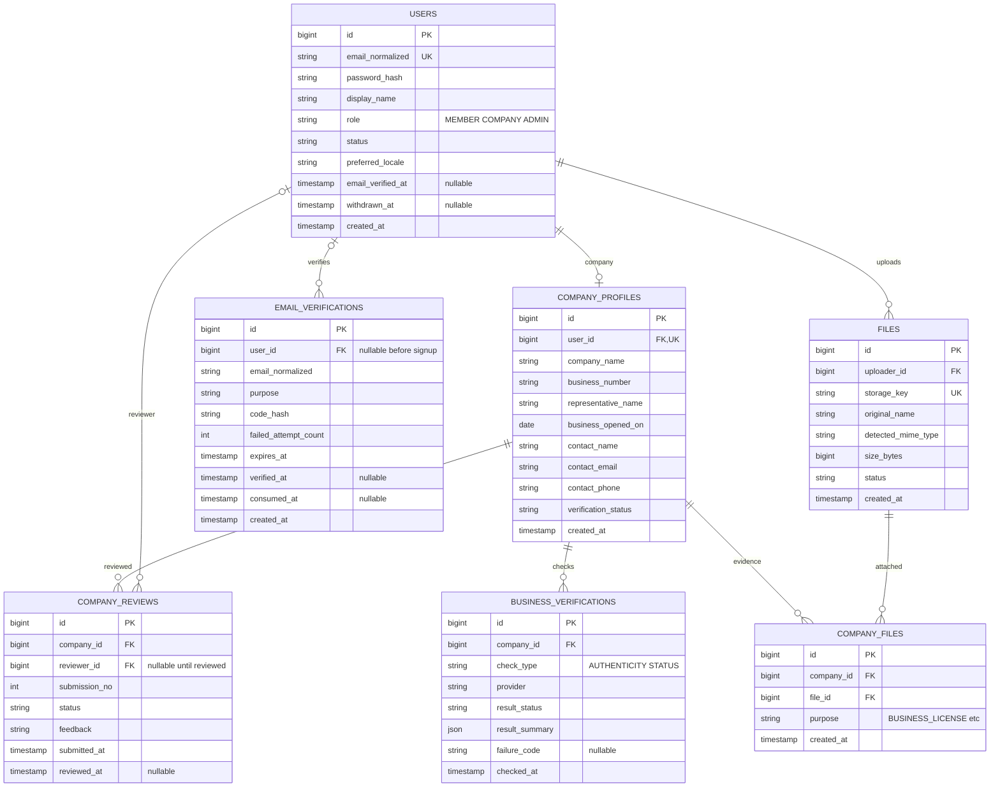
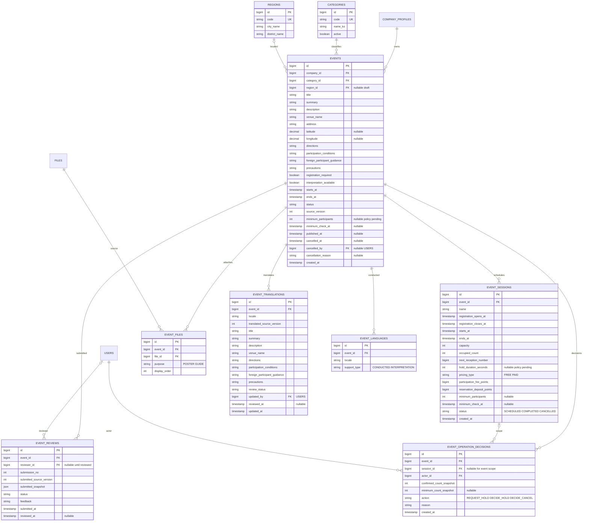
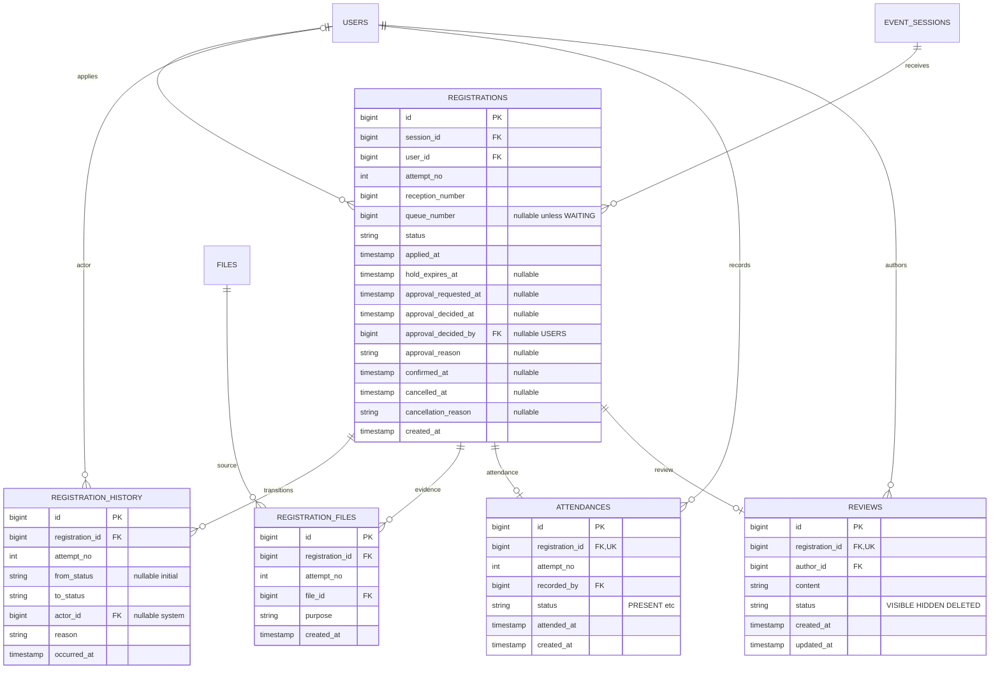
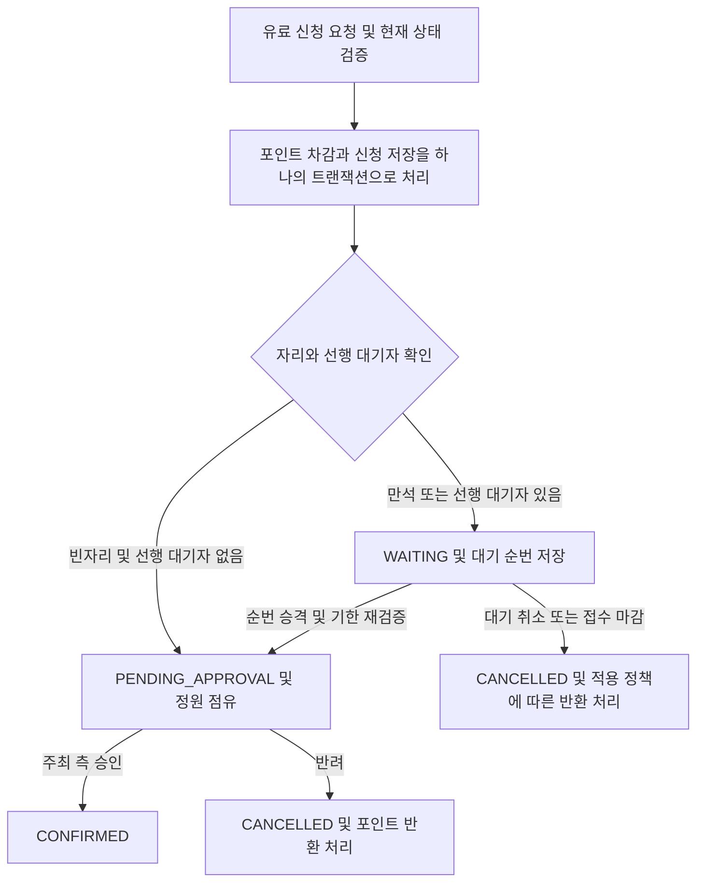
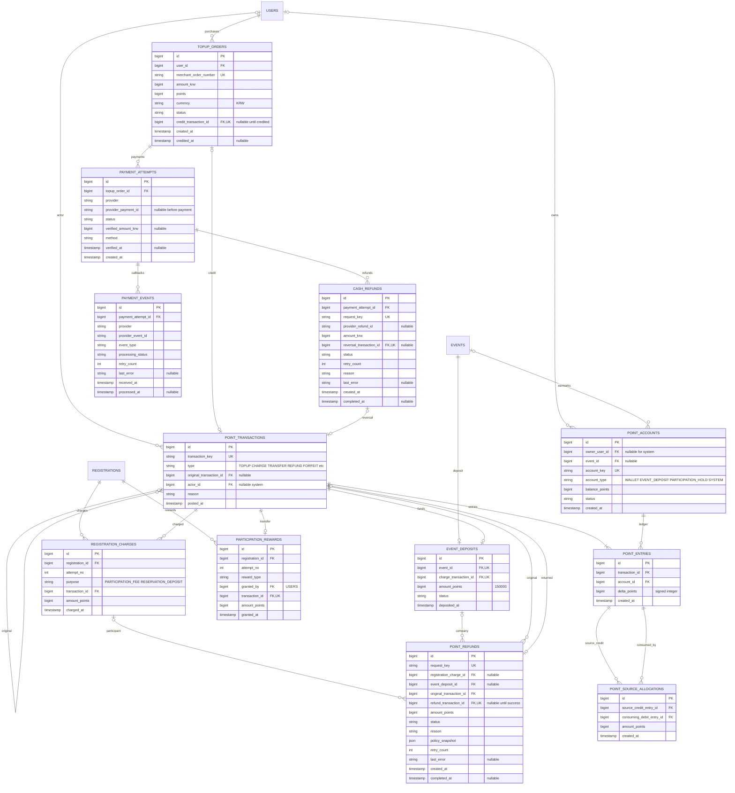
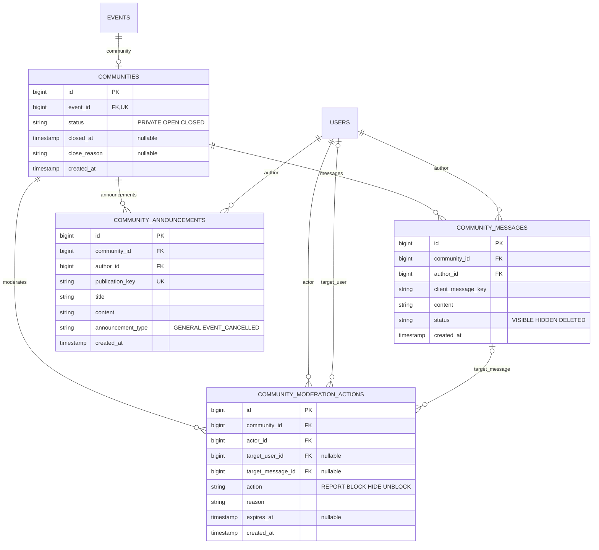
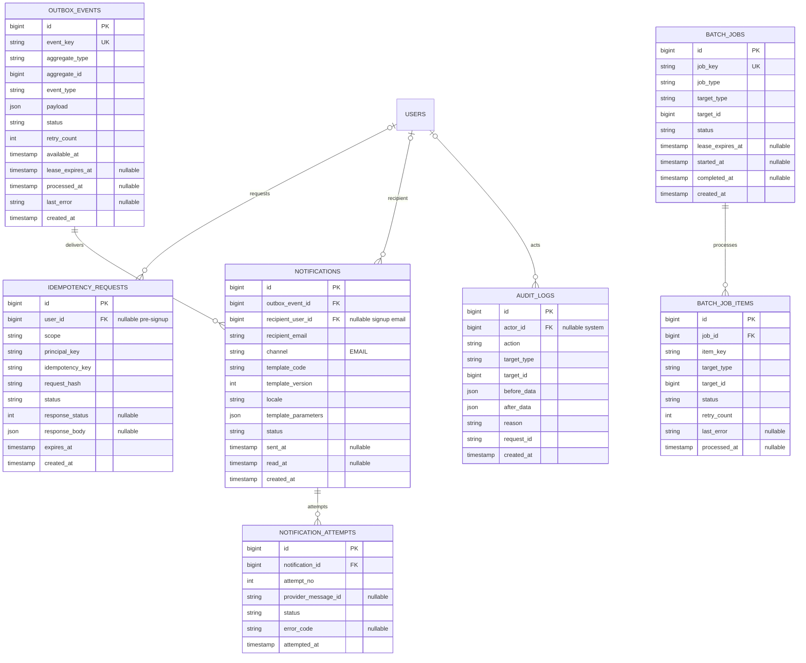

# 부산 문화행사 플랫폼 ERD

기준 문서: [부산 청년·외국인 문화행사 플랫폼 최종 기획안](부산_청년·외국인_문화행사_플랫폼_최종_기획안.md)  
작성일: 2026-11-04  
구분: 기획안 기반 논리 ERD 제안. 실제 DB 마이그레이션·엔티티 구현은 포함하지 않는다.

## 1. 범위와 읽는 방법

기존 13개 테이블을 유지하고 직접 구현 범위의 데이터를 확장했다. 아래 6개 Mermaid ERD는 하나의 모델을 영역별로 나눈 것이다. 같은 이름의 테이블은 동일 테이블이다. `PK`는 기본키, `FK`는 외래키, `UK`는 단일 컬럼 유일키다. 복합 유일키와 CHECK는 8절에 별도로 정리한다. 필드명에 `_id`가 있어도 FK 표시가 없는 다형적 참조는 실제 FK가 아니다.

- ID는 DB 생성 `bigint`, 포인트·원화는 소수점 없는 `bigint`, 시각은 PostgreSQL `timestamptz`를 사용한다. 저장·비교는 UTC, 화면·날짜 경계는 한국 시각을 적용한다.
- ERD의 `string`은 `varchar` 또는 `text`, `json`은 `jsonb`, `timestamp`는 `timestamptz`의 논리 표기다. 길이와 인덱스 세부 사항은 물리 설계에서 정한다.
- 역할·상태는 코드 문자열이며 상태 허용 목록은 CHECK 또는 코드 관리 방식으로 제한한다. DB ENUM 사용 여부는 확정하지 않는다.
- 관계선의 필수성은 운영 데이터 기준이다. 초안이나 처리 중 상태의 NULL 허용 여부는 아래 설명을 함께 따른다.
- 기존 행사·회차 구조를 보존한다. 전체·부분 행사 계층, 기업 공동 관리자, 지정 좌석, QR 출석은 추가하지 않는다.
- 외부 행사 기능은 동결, 광고·구독·유료 발송·티켓 중개 상품 모델은 추후 구체화 범위이므로 본 ERD에서 제외한다. 참가비 보관·반환을 위한 공통 계정은 포함하되 수수료율과 정산 자동화는 확정하지 않는다.
- 생성 시각은 변경 이력이 필요한 모든 테이블에 둔다. 아래는 주요 필드를 제시하며 가변 본문·현재 상태 테이블에는 `updated_at`을 추가한다. 원장·심사·상태 이력은 수정 대신 새 이력으로 남긴다.

**문서 내부 차이:** 최신 3절 흐름도는 유료 신청 시 포인트를 먼저 차감하고 대기열에 등록한다. 7.1절 상태도와 8.4절은 아직 승격 후 차감 설명을 포함한다. 본 설계는 사용자가 요청한 최신 3절을 우선하며 원본 기획안의 다른 절은 변경하지 않았다. 유료 `WAITING`에도 이미 차감한 포인트가 존재하므로 대기 취소·접수 마감 처리에도 반환 판단과 원장 기록이 필요하다. 자발적 대기 취소의 반환 비율 등은 미정으로 둔다.

## 2. 회원·기업 검증·파일

기업 계정과 기업 프로필은 1:0..1 관계다. 기업당 사용자 한 명을 두는 현재 범위이며 공동 관리자 모델을 도입하지 않는다. 기업 상태는 `PENDING / APPROVED / FEEDBACK_REQUIRED / SUSPENDED`를 기준으로 한다. 사업자번호 중복 허용 여부는 기획안에 없으므로 유일키로 확정하지 않았다. 이메일 인증은 가입 이전에도 가능하도록 사용자 FK를 선택값으로 둔다. 인증번호는 원문을 저장하지 않고 재사용을 차단한다.

## 3. 행사·회차·심사·다국어

행사와 회차는 초안에서 1:0..N이며 공개 시 유효 회차 1개 이상을 검사한다. 시간에 따라 변하는 모집 예정·모집 중·마감은 저장하지 않고 계산한다. 번역에도 금액·정원·일정을 복제하지 않는다. 한국어 원문은 `EVENTS`, 외국어 번역은 `EVENT_TRANSLATIONS`에 저장하며 원문 버전 변경 시 번역을 재검토 대상으로 전환한다. UI·상태·카테고리 코드의 번역은 리소스 파일로 관리한다.

카테고리 단일 분류, 지역 코드 테이블, 회차별 가격은 본 ERD의 설계 제안이다. 기획안은 다중 카테고리 여부와 회차별 가격 차등을 확정하지 않았으며 이 구조가 차등 운영 의무를 뜻하지 않는다. 최소 인원·판정 시점의 행사/회차 컬럼은 집계 단위 결정을 위한 선택값이며 활성 집계 단위 하나만 사용한다. 전체·부분 행사 구성으로 해석하지 않는다. 기업 개최 신청과 주최 측 최종 결정은 별도 행으로 기록한다.

## 4. 신청·대기열·승인·출석·후기

신청 상태는 `HOLD / WAITING / PENDING_APPROVAL / CONFIRMED / CANCELLED / EXPIRED`다. 같은 회차·회원의 신청은 한 행만 유지하고 재신청 때 `attempt_no`와 접수 번호를 증가시킨다. 신청 거래·파일·이력에는 시도 번호를 남겨 이전 결제나 증빙이 현재 시도와 섞이지 않게 한다. 출석이 발생한 신청은 취소·재신청하지 않는다. 후기의 작성자는 신청 회원과 같아야 하며 출석 기록을 확인한다. 평점 사용 여부는 미정이므로 평점 컬럼을 추가하지 않았다.

대기 순번과 접수 번호는 별개다. 회차 잠금 아래 현재 `WAITING`의 마지막 번호 + 1, 없으면 1을 부여한다. 대기 종료 시 현재 행의 `queue_number`를 NULL로 비워 순번 재사용 충돌을 막는다. 접수 번호는 `next_reception_number`로 새로 발급한다. 과거 전체 대기 순위 재현은 추가 요구로 만들지 않는다.

최신 유료 신청 흐름은 다음과 같다.

차감 실패 시 신청·대기 등록도 롤백한다. 대기 승격은 같은 시도의 기존 성공 차감을 확인하며 추가 차감하지 않는다. `HOLD`는 기존 임시 확보 모델을 보존하기 위한 상태이며, 이미 결제한 대기자가 반드시 HOLD를 다시 거쳐야 한다는 뜻은 아니다. 직접 신청의 HOLD 유지 여부·확보 시간·승인 기한은 정책 확정 후 정한다. 무료는 자리 확보 시 곧바로 `CONFIRMED`다.

## 5. 포인트·현금 충전·보증금·반환

### 원장 설계 제안

기획안의 지갑·원장·보증금 예치·참가비 보관을 한 종류의 `POINT_ACCOUNTS`로 표현한다. `WALLET`은 사용자 지갑, `EVENT_DEPOSIT`은 행사 보증금 보관, `PARTICIPATION_HOLD`는 참가비·예약금 보관, `SYSTEM`은 현금 충전 대응 등 시스템 계정이다. 계정 키는 사용자 지갑과 행사별 용도 계정의 중복 생성을 막는다. 사용자당 지갑은 하나다. 시스템 발행 대응 계정 외에는 잔액 음수를 허용하지 않는다.

모든 완료 거래는 최소 두 개의 원장 행으로 기록하고 `SUM(delta_points) = 0`을 만족시킨다. 예를 들어 보증금은 기업 지갑 -150,000 / 행사 보증금 계정 +150,000, 보상은 기업 지갑 -N / 참가자 지갑 +N이다. 충전은 시스템 대응 계정 -N / 사용자 지갑 +N이다. 거래 헤더와 원장 행은 DB 트랜잭션에서 함께 커밋하며 처리 중 외부 작업은 결제·반환 요청 테이블에서 관리한다.

참가비와 참가자 예약금은 `REGISTRATION_CHARGES.purpose`로 분리한다. 동시에 차감하면 동일 거래에 연결할 수 있지만 목적별 금액은 각각 남긴다. 합산액과 실제 원장 차감액은 같아야 한다. 기업 보증금은 행사당 한 건만 생성하며 심사 재제출 시 재사용한다. 반환은 원거래를 수정하지 않고 별도 역방향 거래를 생성한다. `POINT_REFUNDS`는 참가자 차감 또는 기업 보증금 중 정확히 하나를 대상으로 한다.

`POINT_SOURCE_ALLOCATIONS`는 차감한 포인트가 어느 충전·이체 유입분에서 나왔는지 연결하는 제안이다. 현금 충전 원결제의 미사용분 검증과 보상 포인트의 출처 추적을 지원한다. 소진 순서와 현금 환불 허용 정책은 미정이다. 원천 배분 없이 충전별 미사용분을 정확하게 판정할 수 있다고 가정하지 않는다. 배분은 거래·원장과 함께 원자적으로 기록하고, 출처를 따라 이체·반환을 추적한다.

현금 환불은 PG와 DB를 하나의 트랜잭션으로 묶을 수 없으므로 요청 키·상태·재조회로 복구한다. 승인된 환불을 처리하는 동안 해당 포인트를 별도 보류 계정으로 이동해 재사용을 막고, 성공 시 시스템 계정으로 반환하며 실패 확정 시 원지갑으로 복원하는 방식은 후속 구현 설계 사항이다. 관련 정책 확정 전 현금 환불 기능을 자동 활성화하지 않는다.

## 6. 행사 커뮤니티

행사 생성 시 커뮤니티도 생성한다. 관계 표기는 초안·생성 처리 중 상태를 포함해 0..1이지만 정상 등록 완료 시 반드시 한 건이어야 한다. 별도 참가자 멤버십 테이블은 두지 않고 신청 상태와 현재 시도의 차감 성공 여부로 접근 권한을 계산한다. 확정 참가자만 입장하며 승인 대기·취소자는 접근할 수 없다. 종료 시각에는 저장된 커뮤니티 상태와 별개로 서버 시각을 확인해 기존 소켓 연결까지 차단한다.

신고·차단·관리자 조치는 기획안의 운영 보완 제안에 해당한다. 조치 대상 메시지·사용자가 같은 커뮤니티 소속인지 검증하며 신고자와 관리자 조치자를 `actor_id`에 기록한다. 취소 공지는 `publication_key`로 재시도 중복을 막는다. 메시지·공지 보관 기간과 폐쇄 이후 조회 권한은 미정이다.

## 7. 이메일 알림·재처리·감사

업무 변경과 `OUTBOX_EVENTS`를 같은 트랜잭션에 저장한다. 이메일 발송은 커밋 후 처리하며 DB 잠금을 외부 호출 동안 유지하지 않는다. 가입 인증 이메일은 사용자 생성 전에도 발송할 수 있다. 알림함의 읽음 시각은 플랫폼 내 열람 기준이며 실제 이메일 열람을 보장하지 않는다. 이메일 사업자가 멱등 키를 지원하지 않으면 응답 유실 시 외부 발송 자체의 정확히 한 번 실행을 DB만으로 보장할 수 없다.

`aggregate_type/id`, `target_type/id`는 다형적 참조라 DB FK를 걸지 않는다. 도메인별 허용 타입·소유권·대상 존재 검사를 서버에서 수행한다. 감사 데이터에는 인증 코드·비밀번호·PG 비밀값을 저장하지 않는다. 일괄 작업은 행사 취소, 대기 정리, HOLD 만료, 반환, 커뮤니티 종료 등을 항목별로 재개할 수 있게 한다.

## 8. 주요 DB 제약과 트랜잭션 규칙

### 유일 제약

| 대상 | 제약 |
|---|---|
| USERS | `UNIQUE(email_normalized)` |
| COMPANY_PROFILES | `UNIQUE(user_id)` |
| COMPANY_REVIEWS / EVENT_REVIEWS | 각각 `(company_id, submission_no)` / `(event_id, submission_no)` 유일 |
| EVENT_TRANSLATIONS | `UNIQUE(event_id, locale)` |
| EVENT_LANGUAGES | `UNIQUE(event_id, locale, support_type)` |
| COMPANY_FILES / EVENT_FILES | 각각 `(company_id, file_id, purpose)` / `(event_id, file_id, purpose)` 유일 |
| REGISTRATIONS | `UNIQUE(session_id, user_id)`, `UNIQUE(session_id, reception_number)`, `UNIQUE(session_id, queue_number)` |
| REGISTRATION_FILES | `UNIQUE(registration_id, attempt_no, file_id)` |
| ATTENDANCES / REVIEWS | 각각 `UNIQUE(registration_id)` |
| POINT_ACCOUNTS | `UNIQUE(account_key)` 및 `WALLET`의 `owner_user_id` 부분 유일 인덱스 |
| POINT_ENTRIES | `UNIQUE(transaction_id, account_id)` 제안. 같은 거래·계정의 증감은 합산 |
| PAYMENT_ATTEMPTS | `(provider, provider_payment_id)` 유일. 결제 전 NULL 허용 |
| PAYMENT_EVENTS | `UNIQUE(provider, provider_event_id)` |
| CASH_REFUNDS | `(payment_attempt_id, provider_refund_id)` 유일. PG별 식별 범위 확인 후 물리 설계 |
| REGISTRATION_CHARGES | `UNIQUE(registration_id, attempt_no, purpose)` |
| PARTICIPATION_REWARDS | `UNIQUE(registration_id, attempt_no, reward_type)` 제안. 동일 유형 중복 보상 차단 |
| POINT_SOURCE_ALLOCATIONS | `UNIQUE(source_credit_entry_id, consuming_debit_entry_id)` |
| COMMUNITIES | `UNIQUE(event_id)` |
| COMMUNITY_MESSAGES | `UNIQUE(community_id, author_id, client_message_key)` |
| IDEMPOTENCY_REQUESTS | `UNIQUE(scope, principal_key, idempotency_key)`; NULL 없는 주체 키로 가입 전 요청도 구분 |
| NOTIFICATIONS | `UNIQUE(outbox_event_id, recipient_email, channel, template_code)` |
| NOTIFICATION_ATTEMPTS | `UNIQUE(notification_id, attempt_no)` |
| BATCH_JOB_ITEMS | `UNIQUE(job_id, item_key)` |

PostgreSQL의 일반 유일 제약은 NULL을 여러 개 허용하므로 대기 종료자의 `queue_number = NULL`을 허용할 수 있다. 재신청 시 접수 번호는 새 값으로 바꾸고 시도별 기록은 이력과 거래에서 구분한다.

### 행 단위 검증

- `capacity > 0`, `0 <= occupied_count <= capacity`, 모든 차감·지급·반환 금액은 양수다. 참가비·예약금 설정값은 0 이상이다.
- 회차는 `registration_opens_at < registration_closes_at <= starts_at < ends_at`을 만족한다. 초안의 미입력 허용과 공개 시 필수 검증은 구분한다.
- `WAITING`이면 대기 순번이 양수이고 다른 상태에서는 NULL이다. `HOLD`이면 확보 기한이 필요하다.
- `TOPUP_ORDERS.amount_krw = points`, `currency = 'KRW'`다. 서버 검증된 성공 결제만 적립 거래에 연결한다.
- `EVENT_DEPOSITS.amount_points = 150000`이다. 수수료와 합쳐 분할 관리하지 않는다.
- `POINT_REFUNDS`는 `registration_charge_id`, `event_deposit_id` 중 정확히 하나만 가진다. 성공 상태에는 반환 거래·완료 시각이 필요하다.
- 지갑 계정에는 사용자 FK가 필수다. 보관 계정의 행사와 사용자 지갑의 소유자를 계정 유형별로 검증한다.

### 여러 행에 걸친 검증

아래는 일반 CHECK만으로 보장할 수 없으므로 잠금·트랜잭션·서버 검사 또는 지연 제약 트리거가 필요하다.

- `occupied_count`는 해당 회차의 `HOLD + PENDING_APPROVAL + CONFIRMED` 합계와 일치한다. 상태 전이에 성공한 경우만 증감하고 대조 작업으로 검증한다.
- 행사 → 회차 → 신청 순서를 기본으로 하되 포인트 계정을 포함한 전체 잠금 순서는 구현 전에 하나로 정한다. 여러 계정은 ID 순서 등 일정한 기준으로 잠근다.
- 신청 차감·신청/대기 등록·원장·상태 이력·아웃박스는 함께 커밋한다. 선행 대기자 승격과 신규 배정은 같은 회차 잠금 아래 처리한다.
- 포인트 거래는 원장 합계 0, 계정 잔액은 원장 합계와 일치한다. 참가자 차감은 현재 시도의 목적별 거래 합계와 일치해야 한다.
- 동일 충전 주문은 성공 적립 거래 하나만 가진다. 중복 PG 성공 통지와 별도 결제 시도의 성공을 모두 같은 주문 기준으로 잠가 확인한다.
- 원거래별 성공 반환 누계와 예약된 반환액은 원거래의 반환 가능 금액을 초과하지 않는다. 목적별 반환도 각 `REGISTRATION_CHARGES.amount_points`를 넘지 않는다. 실패 재시도는 같은 반환 요청을 재사용한다.
- 반환 원거래는 지정된 보증금/신청 차감 거래와 일치해야 한다. 보상 거래의 기업 차감액과 참가자 적립액도 일치해야 한다.
- 원천 배분은 출처가 양의 원장 행, 소비가 음의 원장 행이어야 하며 배분 합계가 각 유입·차감 한도를 넘지 않게 한다.
- 기업 승인·자사 행사 소유권·심사 버전·증빙 파일 접근을 확인한다. 행사 공개 시 포스터·회차·일정·보증금·심사 승인을 확인한다.
- 운영 결정의 `session_id`가 있으면 그 회차의 `event_id`가 결정 행의 `event_id`와 같아야 한다.
- 출석은 현재 확정 신청에만 허용하고, 후기 작성자와 출석 대상 회원이 일치해야 한다. 행사 종료 전만 신규 후기를 허용한다.
- 커뮤니티 접근은 현재 확정 신청과 유료 차감 확인을 기준으로 검사한다. 취소 시 즉시 회수하고 종료 시 기존 연결까지 차단한다.
- 주요 업무 데이터와 원장은 기본적으로 연쇄 삭제하지 않는다. 탈퇴 익명화·파일 삭제·이력 보관은 P16 확정 뒤 적용한다.

### 권장 인덱스

| 조회·작업 | 인덱스 후보 |
|---|---|
| 행사 목록 | `EVENTS(status, region_id, category_id, starts_at)` |
| 기업 행사 관리 | `EVENTS(company_id, created_at)` |
| 회차 접수·마감 | `EVENT_SESSIONS(event_id, starts_at)`, `(status, registration_closes_at)` |
| 순번 승격 | `REGISTRATIONS(session_id, queue_number) WHERE status = 'WAITING'` |
| HOLD 만료 | `REGISTRATIONS(hold_expires_at) WHERE status = 'HOLD'` |
| 내 신청 | `REGISTRATIONS(user_id, applied_at)` |
| 원장 조회 | `POINT_ENTRIES(account_id, created_at, id)` |
| 반환 대조 | `POINT_REFUNDS(original_transaction_id, status)` |
| 채팅 과거 내역 | `COMMUNITY_MESSAGES(community_id, id)` |
| 발송·재처리 | `OUTBOX_EVENTS(status, available_at)`, `NOTIFICATIONS(status, created_at)` |

검색용 전문검색 인덱스, 복합 인덱스 컬럼 순서와 추가 FK 인덱스는 실제 조회·실행 계획에 따라 확정한다.

## 9. 요구사항 대응과 미정 사항

| 기획안 영역 | 주요 테이블 |
|---|---|
| 가입·기업 검증 | USERS, EMAIL_VERIFICATIONS, COMPANY_PROFILES, COMPANY_REVIEWS, BUSINESS_VERIFICATIONS, COMPANY_FILES |
| 행사·심사·다국어 | EVENTS, EVENT_SESSIONS, EVENT_REVIEWS, EVENT_FILES, CATEGORIES, REGIONS, EVENT_TRANSLATIONS, EVENT_LANGUAGES |
| 선착순·대기·승인 | REGISTRATIONS, REGISTRATION_HISTORY, REGISTRATION_FILES |
| 충전·포인트·반환 | POINT_ACCOUNTS, POINT_TRANSACTIONS, POINT_ENTRIES, TOPUP_ORDERS, PAYMENT_ATTEMPTS, PAYMENT_EVENTS, CASH_REFUNDS, EVENT_DEPOSITS, REGISTRATION_CHARGES, POINT_REFUNDS, POINT_SOURCE_ALLOCATIONS |
| 개최·취소 판단 | EVENT_OPERATION_DECISIONS, BATCH_JOBS, BATCH_JOB_ITEMS |
| 출석·후기·보상 | ATTENDANCES, REVIEWS, PARTICIPATION_REWARDS |
| 커뮤니티 | COMMUNITIES, COMMUNITY_MESSAGES, COMMUNITY_ANNOUNCEMENTS, COMMUNITY_MODERATION_ACTIONS |
| 알림·보안·재처리 | FILES, IDEMPOTENCY_REQUESTS, OUTBOX_EVENTS, NOTIFICATIONS, NOTIFICATION_ATTEMPTS, AUDIT_LOGS |

다음은 기획안에 따라 미정으로 유지한다. 이 문서의 컬럼·상태 제안이 정책 확정을 의미하지 않는다.

1. 전체·부분 행사 및 다회차 운영 방식, 커뮤니티 공유 단위(P02).
2. HOLD 시간·승인 기한, 최신 선차감 흐름에 맞춘 기존 7·8절의 상태도 정리(P01).
3. 참가비·예약금의 관계·금액, 대기 취소·접수 종료·자진 취소·노쇼별 반환 규칙(P08).
4. 영업일 달력·보증금 반환 경계·최종 반려·귀책·분쟁 처리(P04·P05·P07).
5. 최소 인원 값·판정 시각·행사 또는 회차 집계 단위(P09).
6. 보상액·시점·유효기간·취소 회수, 충전분 소진 순서·현금 환불 범위·출금 여부(P10).
7. 종료 후 후기 열람·수정·삭제, 메시지·증빙·원장 등 보관 정책(P11·P16).
8. 수익화 상품·수수료·정산 시점·광고·구독·유료 발송 세부 모델(P13).
9. PG·메일·저장소·번역 사업자 및 해외 발급 카드 지원(P15·P18·P19).
