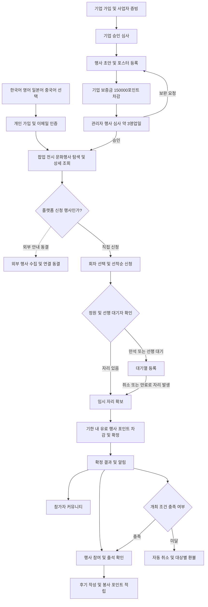
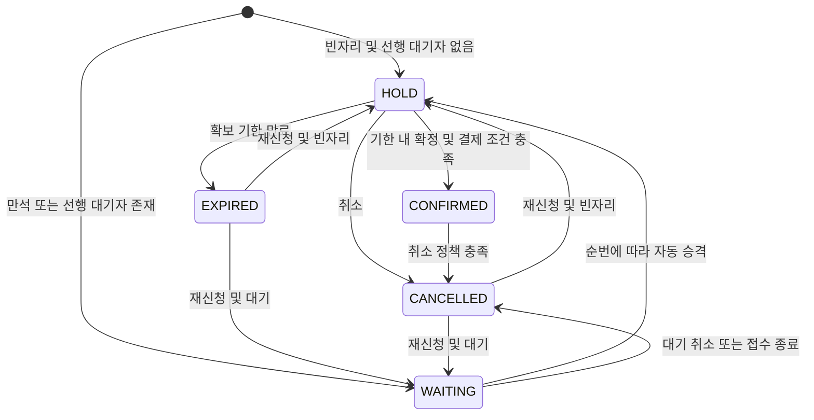

# 부산 청년·외국인을 위한 문화행사·팝업·전시 플랫폼 최종 기획안

작성일: 2026-11-02  
문서 성격: 부산 청년·외국인 대상 서비스 취지, 영어·일본어·중국어 지원, 기존 기능·포인트·수익화 정책을 통합한 최종본

## 적용 범위와 동결 원칙

**외부 행사 관련 기능만 [동결]한다.** 외부 행사 정보 수집·연동·중복 판별·목록 및 상세 노출·외부 신청처 연결과 관련 데이터·화면은 요구사항만 보존하고 구현·활성화를 보류한다. 부산 지역의 플랫폼 자체 행사 운영은 정상 구현 범위다.

**가입 검증, 기업 검증, 행사 심사, 결제·환불, 최소 개최 인원, 후기, 포인트 시스템, 커뮤니티와 수익화 전부를 직접 구현한다.** 사업자 확인 API·지도·PG·발송 사업자 연동은 외부 행사 기능과 별개이며 동결하지 않는다. 직접 구현은 서비스의 업무·상태·권한·원장·화면·API를 구현한다는 뜻이며 외부 결제사 등 필요한 사업자 연동을 배제하지 않는다.

**금전 가치는 1포인트 = 1원으로 통일한다.** 기업·개인 사용자는 현금 결제로 포인트를 사전 충전하고, 플랫폼 내부의 보증금·참가비·참가자 예약금·광고·수수료·발송·구독 등은 포인트 차감·지급·반환으로 처리한다. 행사 등록과 동시에 보증금을 현금 결제하는 방식은 사용하지 않는다.

**한국어를 기본으로 영어·일본어·중국어를 우선 추가하고 다국어 서비스를 직접 구현한다.** 중국어 표기는 우선 간체로 제안하며 번체 추가는 추후 결정한다.

본 절과 1·5·8·13·16·17·18절이 기존 제안보다 우선한다. 기존의 비외부행사 기능 동결 결정은 철회한다. 이번에 변경하지 않은 정책과 미정값은 유지한다.

## 1. 프로젝트 개요

### 1.1 서비스 정의

부산의 청년층과 부산을 방문하는 외국인 관광객이 팝업스토어·전시·문화행사·체험 프로그램·특강·봉사 정보를 쉽고 빠르게 탐색하고 실제 참여까지 이어갈 수 있는 다국어 웹 플랫폼이다. 기업·브랜드·문화공간·전시 및 행사 주최자는 검증된 계정으로 행사를 등록하고, 참가 모집·포인트 거래·출석·후기·커뮤니티까지 운영한다.

서비스의 중심은 **‘부산에서 무엇을 즐길지 찾고, 이해하고, 참여하기 쉽게 만드는 것’**이다. 부산 청년층을 핵심 이용자로 두고 외국인 관광객·유학생·거주 외국인까지 사용성을 넓힌다. 한국어에 영어·일본어·중국어를 우선 추가한다. 부산에서 먼저 운영하고 이후 다른 지역 확장을 검토한다.

플랫폼에 직접 등록된 행사를 중심으로 서비스한다. 외부 행사 사이트의 정보 수집·연동·목록 노출은 기존대로 [동결]하며, 지역 정보 접근성을 높인다는 목적 때문에 자동으로 재개하지 않는다. 초기 정보량은 지역 주최자의 직접 등록과 입점 협력으로 확보한다.

### 1.2 개발 배경과 문제의식

부산의 청년들이 팝업스토어나 전시를 즐기고 싶어도, 언제·어디서·어떤 행사가 열리는지 찾고 비교하기 어렵다는 문제를 출발점으로 삼는다. SNS 계정, 브랜드 공지, 개별 공간의 게시물 등 여러 경로를 확인해야 하면 행사 발견부터 신청까지 탐색 부담이 커질 수 있다. 행사에 관심이 있어도 모집 마감을 놓치거나, 방문 조건을 확인하지 못해 참여를 포기하는 상황을 줄이고자 한다. 이러한 청년층의 불편은 이번 프로젝트가 검증할 문제 가설이며, 실제 설문 결과로 단정하지 않는다.

외국인 관광객에게는 정보 분산에 더해 언어 장벽이 생긴다. 한국어 포스터 중심의 안내만으로는 일정·장소·참가 조건·비용·신청 방법을 이해하기 어려울 수 있다. 유명 관광지 안내를 넘어, 방문 기간에 참여할 수 있는 지역 문화 경험을 찾고 실제 신청하도록 돕는 데 의미가 있다.

한국관광공사 게시 ‘2025년 12월 외국인 관광객 부산방문 동향보고’에 따르면 2025년 부산 외국인 방문객 누계는 **3,643,439명**으로 2024년 **2,929,192명**보다 **24.4% 증가**했다. 이는 외국인 이용자를 고려할 배경 근거이며, 이 수치만으로 팝업·전시 수요나 본 서비스 이용 의사를 입증하는 것은 아니다. 영어·일본어·중국어는 팀이 정한 우선 지원 언어이며 이 통계에 따른 언어별 순위라고 주장하지 않는다. [한국관광공사 게시 통계·부산관광공사 원자료 안내](https://touraz.kr/statistics?bbsSeq=642916&boardMode=V)

### 1.3 개발 목적과 서비스 명분

**즐길 의향이 있는 사람이 정보 부족이나 언어 장벽 때문에 참여 기회를 놓치지 않도록, 부산의 문화행사를 발견하고 참여하는 과정을 한곳에서 연결한다.** 청년에게는 일상에서 활용하기 좋은 지역 문화 탐색 도구를, 외국인에게는 이해 가능한 언어로 부산의 지역 문화를 경험할 접점을, 주최자에게는 참가자와 만나는 운영 채널을 제공한다.

| 대상 | 불편과 필요 | 제공 가치 |
|---|---|---|
| 부산 청년·대학생·사회초년생 | 팝업·전시·체험에 관심은 있지만 정보를 찾고 비교하기 번거로움 | 카테고리·장소·기간·비용별 탐색과 신청·참여 내역 연결 |
| 부산 방문 외국인 관광객 | 방문 기간에 맞는 행사를 발견하고 한국어 안내·신청 조건을 이해하기 어려움 | 영어·일본어·중국어 화면과 행사 핵심 안내·신청 흐름 |
| 유학생·거주 외국인 | 지역 문화 참여와 교류 기회를 지속적으로 찾을 필요 | 다국어 탐색·신청과 참가자 커뮤니티 |
| 기업·브랜드·문화공간·행사 기관 | 청년·외국인 대상 홍보와 참가 관리가 분리됨 | 직접 등록·검증·심사·모집·출석·후기·수익화 운영 |

### 1.4 핵심 문제와 해결 방향

| 문제 | 해결 방향 |
|---|---|
| 즐길 의향과 실제 행사 참여 사이의 정보 탐색 장벽 | 팝업·전시·문화행사 중심 목록과 날짜·지역·카테고리·가격·마감 필터 |
| 한국어 위주 정보로 인한 외국인 이용 장벽 | 한국어·영어·일본어·중국어 UI, 행사 핵심 정보와 신청·포인트·환불 안내 |
| 포스터 이미지에만 존재하는 중요한 정보 | 일정·장소·비용·참가 조건을 검색·번역 가능한 텍스트로 별도 제공 |
| 허위 주최자·불건전 행사·일방 취소 | 기업 검증, 관리자 심사, 보증금 포인트 예치·차등 반환 |
| 신청 경쟁·중복 신청·불공정한 대기 처리 | 정원 동시성 제어, HOLD·대기열·자동 승격 |
| 참여 이후 운영과 신뢰 부족 | 참가 확정·출석·실제 참가자 후기·참가자 커뮤니티 |
| 행사 참여 비용과 보상 관리 | 사전 충전 지갑, 1포인트 = 1원, 주최 측 포인트 지급과 사용 |

### 1.5 기대 효과와 검증 지표

청년의 문화생활 정보 접근성과 외국인의 지역 행사 이용 편의를 높이고, 지역 주최자의 참가자 확보·운영 부담을 줄이는 것을 기대한다. 문화 소비·지역 공간 방문·브랜드와 이용자의 접점 확대는 기대 효과이며, 지역경제 성장이나 관광 소비 증가를 이미 달성했다고 표현하지 않는다.

서비스 지표는 카테고리별 조회·검색 후 상세 이동률, 상세에서 신청 전환율, 검색 결과 없음 비율, 신청 완료까지의 이탈률, 재방문·재참여율로 측정한다. 다국어는 언어별 이용·행사 번역 제공률·신청 전환·오류 및 문의 비율을 추가한다. 운영 지표는 심사 처리 기간, 정원 충족·대기 승격·출석·취소·후기 작성률, 충전·포인트 반환·알림 실패율이다. 외부 정보 갱신 지표는 외부 행사 동결 해제 후 적용한다.

개발 초기에는 청년·외국인 이용자의 ‘원하는 날짜의 팝업 또는 전시 찾기 → 장소·비용 이해 → 신청’ 과제를 관찰하여 정보 구조와 다국어 사용성을 검증한다. 목표 수치와 청년의 정확한 연령 기준은 팀에서 별도 정하며 청년 외 이용자의 가입·탐색을 제한하지 않는다.

### 1.6 발표·제안용 기획 취지

부산에는 팝업스토어와 전시, 다양한 문화행사를 즐기고 싶은 청년들이 있지만, 필요한 정보를 한눈에 찾고 비교하기 어려워 참여 기회를 놓칠 수 있습니다. 부산을 찾는 외국인 관광객에게는 한국어 중심의 안내가 또 다른 장벽이 됩니다. 이 프로젝트는 부산의 청년과 외국인이 원하는 문화행사를 쉽게 발견하고, 이해하고, 직접 참여하도록 돕는 웹 플랫폼을 만드는 데 목적이 있습니다. 한국어·영어·일본어·중국어 안내와 행사 탐색·신청·포인트·참가 관리 기능을 연결하여, 이용자에게는 편리한 문화생활의 시작점을 제공하고 주최자에게는 지역 이용자와 만나는 운영 기반을 제공하고자 합니다.

## 2. 사용자와 권한

| 사용자 | 주요 기능 | 제한 |
|---|---|---|
| 비회원 | 플랫폼 공개 행사 목록·상세 조회. 외부 행사 정보 조회는 [동결] | 신청·후기·커뮤니티 이용에는 로그인 필요라는 통합 제안 |
| 개인 회원 `MEMBER` | 이메일 인증, 행사 신청·확정·취소·재신청, 결제, 포인트, 내 신청, 출석 확인, 후기, 참가자 커뮤니티 | 본인 신청·결제·증빙만 접근 |
| 기업 회원 `COMPANY` | 기업 가입·증빙 제출, 행사 작성·심사 제출·재제출, 보증금 포인트 차감, 자사 참가자 조회·출석 처리·공지·알림, 환불 내역 | 승인된 기업만 행사 심사 제출, 타 기업 행사 관리 불가 |
| 사이트 관리자 `ADMIN` | 기업 승인·반려, 행사 심사·피드백, 부적절한 행사 관리, 취소·보증금 환급 관리, 운영 이력·실패 작업 확인 | 관리자 권한은 일반 가입 화면에서 선택 불가라는 통합 제안 |

기존 ERD의 `ORGANIZER`는 기업 회원 `COMPANY`로 통합한다. 기업의 자사 행사 소유권과 관리자의 플랫폼 운영 권한은 서버에서 검사한다. 기업 승인과 행사 승인은 별개이며, 참가자별 수동 승인 심사는 기본 범위에 포함하지 않는다.

## 3. 전체 서비스 흐름

이미지의 3개 역할과 기업 승인·15만 원 보증금·3일 행사 심사·보증금 반환 흐름을 반영했다. 행사 작성 및 심사 제출 순서는 ‘포인트 사전 충전 → 초안 작성 → 150,000포인트 차감 → 심사 → 공개’로 정리했다. 반려 후 보완 제출은 기존 보증금을 재사용하며 추가 차감하지 않는다.

## 4. 회원가입과 기업 검증

### 4.1 개인 회원

가입 화면 상단에 개인·기업 탭을 제공한다. 개인은 기본 정보 입력 후 이메일 인증번호 발송과 검증을 완료해야 가입할 수 있다. 이메일 중복은 정규화와 유일 제약으로 차단하고, 비밀번호는 해시로 저장한다. 인증번호의 유효시간·재발송 간격·실패 횟수는 설정값으로 관리한다는 통합 제안이다.

### 4.2 기업 회원

기업명, 사업자등록번호, 담당자 연락처와 기업 확인 정보를 받고 사업자등록증 PDF 또는 이미지를 필수 첨부한다. 기업 가입 신청 뒤 관리자가 증빙을 검토하여 승인하거나 보완을 요청한다. 승인 전에는 행사 공개 및 심사 제출을 제한한다는 통합 제안이다.

사업자등록정보 진위확인·상태조회 API 활용을 검토한다. 자료에서 제시한 입력은 진위확인용 사업자등록번호·개업일자·대표자명, 상태조회용 사업자등록번호다. API 결과와 증빙 심사를 함께 사용하고, 장애가 발생하면 확인 대기·관리자 수동 검토로 전환한다. 외부 API의 실제 신청 조건·요청 규격·사용 한도는 구현 시 공식 문서로 확인한다. 본 문서는 API 연동 완료를 의미하지 않는다.

기업 상태는 `PENDING`, `APPROVED`, `FEEDBACK_REQUIRED`, `SUSPENDED`로 분리하는 통합 제안이다. 보완 사유와 검토 이력을 보존한다.

## 5. 행사 탐색과 상세 조회

| 기능 | 상세 내용 |
|---|---|
| 지역 | 초기 부산 중심, 구·군 및 장소별 탐색. 추후 지역 확장 |
| 행사 목록 | 포스터, 제목, 주최 기업, 일정, 장소, 모집 상태, 유료·무료 구분·필요 포인트 |
| 검색·분류 | 키워드·카테고리·부산 지역·방문 또는 참여 희망 기간·유무료·필요 포인트·마감 조건, 정렬·페이지네이션 |
| 카테고리 | 팝업스토어·전시·문화행사·체험·특강·봉사·교류를 우선 구성. 세부 코드는 팀 결정 |
| 마감 임박 | ‘오늘 마감’과 ‘마감 임박’ 목록. 오늘은 한국 시각 기준, 임박 범위는 설정 |
| 행사 상세 | 소개, 포스터, 안내문, 주최자, 주소·지도, 회차·접수 기간·정원·비용·취소 정책 |
| 외부 행사 | **[동결]** 외부 정보 수집·목록·상세 안내·신청처 연결은 재개 전 구현 보류 |
| 유료 상단 노출 | 기업이 광고비를 지불하면 상단·배너에 노출. 참가비 유료 여부와 광고 구매 여부는 별도 관리 |

**[동결: 외부 행사]** 아래 외부 행사 정책은 재개 시 적용한다. 외부 행사는 원문 출처·갱신 시각·신청 경로를 표시하고 플랫폼 내 신청 행사와 구분한다. 수집 경로, 사용 허용 범위, 갱신 주기, 중복 판별은 확정이 필요하다. 외부 행사에는 플랫폼 내 결제·정원·출석·커뮤니티를 자동 제공하지 않는 통합 제안이다. 지도 장애 시 주소를 보여주며 탐색·신청은 계속 이용할 수 있게 한다.

친목 목적 유료 행사 아이디어와 소비향락 행사 금지 제안은 동일 기준이 아니다. 건전한 교류 행사의 허용 여부와 심사 기준은 운영 정책에서 정한다.

### 5.1 청년·관광객 중심의 행사 탐색

메인에서 팝업·전시·문화행사 진입 경로를 눈에 띄게 제공하고 원하는 날짜와 지역을 선택해 비교할 수 있게 한다. ‘오늘 갈 수 있는 행사’와 ‘오늘 신청 마감’은 구분한다. 전자는 실제 운영 기간·회차 기준, 후자는 신청 마감 기준으로 계산한다. 신규 추천 알고리즘이나 자동 개인화는 이번 요구에 추가하지 않는다.

팝업·전시의 전체 운영 기간과 실제 예약 회차를 구분한다. 신청이 필요한 방문은 기존 회차별 정원·HOLD·대기를 사용한다. 예약 없이 관람할 수 있는지 별도 안내하고, 단순 방문 정보 확인만으로 참가 확정·출석·후기 권한을 생성하지 않는다. 전체·부분 행사 신청의 구성은 기존 P02 추후 결정 사항을 유지한다.

### 5.2 다국어 지원 범위 — 직접 구현

| 언어 | 화면 표시 | 적용 방향 |
|---|---|---|
| 한국어 | 한국어 | 기본 언어와 원문 기준 |
| 영어 | English | 우선 추가 지원 |
| 일본어 | 日本語 | 우선 추가 지원 |
| 중국어 | 中文 | 우선 추가 지원. 초기 간체 `zh-CN` 제안, 번체 추가 여부 추후 결정 |

언어 선택은 국적과 분리한다. 모든 주요 화면에서 찾기 쉬운 선택기를 제공하고 로그인 여부와 관계없이 선택을 유지한다. 최초에는 브라우저의 지원 언어와 일치하면 해당 언어, 미지원 언어이면 한국어로 표시하는 것을 구현 제안으로 한다. 이후 사용자가 직접 선택한 값을 우선한다.

| 범위 | 지원 내용 |
|---|---|
| 공통 UI | 메뉴·버튼·카테고리·검색·필터·상태·빈 화면·오류·입력 검증·확인창 |
| 개인 이용 | 회원가입·이메일 인증·로그인·신청·대기·확정·취소·내역·출석·후기·커뮤니티 안내 |
| 행사 핵심 정보 | 제목·요약·상세 소개·장소명·오는 길·참가 조건·접수·운영 일정·주의사항·진행 언어 |
| 포인트·정책 | 충전·잔액·차감·보증금·지급·반환·수수료·취소 규칙 및 확인 안내 |
| 기업·관리자 | 가입·증빙 안내, 등록·심사·운영·수익화 화면의 공통 UI와 상태·검증 메시지 |
| 알림 | 가입 인증·심사·신청·대기 승격·취소·포인트·행사 임박 안내의 언어별 템플릿 |

### 5.3 행사 번역과 실제 이용 조건

UI 문구는 언어별 리소스로 관리하고, 주최자가 작성한 행사 내용은 언어별 번역 필드로 구분한다. 원문·번역·작성 및 갱신 시각·검토 상태를 관리하며 주최자 또는 운영자가 번역을 등록·확인한다. 자동 번역 API의 선택과 사용 여부는 추후 결정하고 자동 번역 완료를 기본 전제로 삼지 않는다.

한국어 원문은 필수로 두고 외국어 번역은 보유 여부를 표시한다. 번역이 없으면 현지화된 안내와 함께 한국어 원문을 제공하며 빈 설명을 표시하거나 번역이 있다고 오인시키지 않는다. 선택 언어 번역이 준비된 행사를 필터링할 수 있게 한다. 번역 검색은 해당 언어와 한국어 원문을 대상으로 하고 제공되지 않은 동의어·음역·언어 간 검색을 자동 지원한다고 약속하지 않는다.

포스터 원본을 임의 변경하지 않으며 중요 정보는 텍스트로도 제공한다. 원문 일정·참가비·취소 조건을 수정하면 관련 번역을 재검토 필요 상태로 전환한다. 잘못된 번역으로 거래 조건이 달라지지 않도록 금액·시간·정원·상태는 같은 원본 데이터에서 표시한다. 조건을 확인할 수 없는 언어에는 명확한 안내와 확인 경로를 제공한다.

행사 상세에는 **안내 번역 언어와 현장 진행 언어를 구분**한다. 사이트를 영어로 볼 수 있다고 현장에서 영어 응대가 가능한 것은 아니다. 주최자가 진행 언어·통역 여부·외국인 참가 조건을 입력하도록 한다. 사용자 후기·채팅·첨부파일 원문은 자동 번역 범위에 포함하지 않으며 공통 UI만 다국어화한다.

외국인 개인 가입은 기존 이메일 인증을 기본으로 유지하고 한국 휴대전화·주민등록번호를 새로운 필수 조건으로 추가하지 않는다. 이름 입력은 한글 전용 검증을 피하고 문자·주소·줄바꿈 표시를 다국어로 검증한다. 기업 증빙·사업자 검증 정책은 유지한다.

충전 화면에서 **1포인트 = 1 KRW(대한민국 원화)**임을 분명히 표시한다. 언어 변경으로 포인트 가치·가격·잔액·기한이 바뀌지 않는다. 외화 환산·다중 통화 결제는 이번 범위에 포함하지 않는다. 외국인의 실제 충전에는 해외 발급 카드 등 PG 지원 여부가 필요하므로 P15에서 확인한다. 다국어 UI만으로 해외 결제 가능을 보장하지 않고 지원 수단·제약을 거래 전에 안내한다.

모든 행사·접수·마감 시각은 한국 표준시 `Asia/Seoul, UTC+9` 기준임을 표시한다. 날짜 표현과 숫자 구분은 언어에 맞게 표시하되 일정 판단과 23시 59분 마감 정책은 동일하다.

## 6. 행사 등록·심사·공개

### 6.1 등록 정보

기업은 자사 행사 초안을 생성하고 제목, 상세 설명, 카테고리, 장소·주소, 행사 일정, 회차별 접수 기간·정원, 안내사항을 입력한다. 대표 포스터는 최소 1개 필수이며 안내문을 추가할 수 있다. 유료·무료 구분과 참가비·참가자 예약금, 최소 개최 인원·판정 시점은 해당 기능을 사용하는 행사에서 입력하도록 제안한다. 행사 공개 시 최소 1개 회차가 필요하다.

### 6.2 기업 보증금 포인트 차감과 심사

기업이 행사 등록·심사 제출 시 사전 충전 지갑에서 보증금 150,000포인트를 차감하면 심사 대기로 접수한다. 잔액 부족 시 충전 안내를 제공하며 등록과 동시에 현금을 직접 결제하지 않는다. 관리자는 약 3영업일을 기준으로 내용을 확인하고 승인 또는 사유가 있는 보완 요청을 한다. 기업은 피드백을 확인하고 수정·재제출한다. 부적절한 소비향락 행사, 불법 다단계, 공익·특강 목적에 위배되는 행사는 게시를 제한한다.

원자료는 행사 시작 최소 7영업일 전에 등록 및 게시가 완료되어야 한다고 제안한다. 따라서 단순히 시작 7일 전에 심사를 신청하는 것으로 충족되지 않는다. 심사 약 3영업일을 추가 고려해야 하며, 안전한 제출 마감과 재심사 여유는 별도 정책으로 정한다. 영업일 달력과 공휴일·접수 마감 시각도 확정해야 한다.

### 6.3 상태 통합

| 구분 | 통합 제안 |
|---|---|
| 행사 | `DRAFT → PENDING_REVIEW → PUBLISHED → COMPLETED` |
| 심사 보완 | `PENDING_REVIEW → FEEDBACK_REQUIRED → PENDING_REVIEW` |
| 취소 | 허용된 행사 상태에서 `CANCELLED`로 전환, 사유·주체 기록 |
| 회차 | `SCHEDULED → COMPLETED / CANCELLED` |
| 모집 표시 | 공개 여부·회차 상태·접수 시각으로 ‘모집 예정/모집 중/마감’을 계산 |

추가 제안의 `OPEN`은 공개 및 모집 가능 상태를 뜻하는 화면 용어로 통합하고, 시간 경과에 따라 바뀌는 모집 상태는 중복 저장하지 않는 ERD 원칙을 유지한다. 이미 참가자가 있는 행사의 일정 변경은 초기 범위에서 제한한다. 공개 후 주요 정보 변경 시 재심사 여부는 정책 결정이 필요하다.

## 7. 선착순 신청·대기열·참가 확정

### 7.1 회차 단위 신청

행사·회차 분리 구조는 기존 설계로 보존한다. 전체 행사 신청과 부분 행사별 신청을 구분할지, 다회차로 운영할지는 P02에 따라 추후 결정한다. 이 구분을 현재 확정된 기능으로 구현하지 않는다. 회차 모델을 사용하는 경우 회원은 여러 회차에 신청할 수 있지만 동일 회차의 신청 레코드는 하나만 가진다. 참가 증빙이 필요한 경우 신청 파일을 첨부할 수 있다. 증빙의 필수 대상은 별도로 정한다.

기본 신청 흐름은 자리 임시 확보 `HOLD` 후 본인 확정 `CONFIRMED`이며, 만석이거나 선행 대기자가 있으면 `WAITING`으로 접수한다. 이는 즉시 확정과 임시 확보 방식 중 ERD의 상세 설계를 채택한 통합 제안이다.

### 7.2 운영 규칙

| 항목 | 규칙 |
|---|---|
| 정원 계산 | `occupied_count = HOLD + CONFIRMED`, 그 외 상태는 정원을 점유하지 않음 |
| 대기 순서 | 회차별 증가 접수 번호를 발급하고 가장 작은 대기 번호부터 승격 |
| 신규 신청 | 선행 대기자가 있으면 먼저 승격시켜 빈자리 가로채기 방지 |
| 임시 확보 | 기한은 `현재 시각 + 확보 시간`과 접수 마감 중 빠른 시각 |
| 접수 일정 | `접수 시작 < 접수 마감 ≤ 행사 시작 < 행사 종료` |
| 접수 종료 | 남은 대기는 취소하고 사유 `REGISTRATION_CLOSED` 기록, 추가 승격 중지 |
| 재신청 | 기존 신청 행을 재사용하되 새 접수 번호·접수 시각·시도 번호 부여 |
| 취소 | 기본안은 회차 시작 전 자발적 취소 허용, 출석 후 취소 금지 |
| 강제 취소 | 관리자·행사 소유자 권한과 사유 확인 |
| 정원 변경 | 현재 점유 인원 아래로 축소 금지 |
| 이력 | 시도별 상태 전이·발생 시각 보존. 과거 대기 순위·확보 기한 전체 재현은 기존 ERD 범위 밖 |

행사 취소 시 신규 신청·확정을 먼저 차단하고 회차별 기존 신청 취소·정원 정리·알림을 재실행 가능한 일괄 작업으로 처리한다. 이미 취소된 건의 정원 반환과 알림을 반복하지 않는다.

## 8. 포인트 충전·차감·보증금·환불

### 8.1 공통 결제 원칙

기업과 개인 모두 포인트 지갑을 사용한다. **현금 결제는 포인트 충전 단계에서만 수행**하고, 플랫폼 내부 거래는 모두 포인트로 처리한다. 1원 결제 시 1포인트가 충전되며 보너스·환산율 변경은 현재 정책에 추가하지 않는다. 충전 내역과 내부 포인트 사용 내역은 별도 기록으로 연결한다.

| 거래 | 처리 방식 |
|---|---|
| 포인트 충전 | 사용자가 금액을 선택하고 현금 결제 → 서버가 결제 검증 → 지갑에 같은 수의 포인트 적립 |
| 기업 행사 보증금 | 행사 등록·심사 제출 시 기업 지갑에서 150,000포인트 차감 → 해당 행사 보증금으로 별도 관리 |
| 유료 행사 참가비·예약금 | 참가자 지갑에서 행사별 지정 포인트 차감, 결제 조건 충족 시 참가 확정 |
| 광고·수수료·발송·구독 | 해당 상품 요금만큼 기업 지갑의 포인트 차감 |
| 주최 측 참여 보상 | 주최 측 지갑에서 포인트 차감 → 유저 지갑에 동일 포인트 지급 |
| 보증금 환급·참가 취소 환불 | 적용 정책에 따른 포인트를 원지갑으로 반환 |
| 티켓 중개 수수료·기업 정산 | 참가비 포인트에서 수수료 산출·분리, 정산 조건 충족 시 기업 지갑으로 포인트 지급 |

내부 거래 화면에서 현금 직접 결제나 현금+포인트 혼합 결제를 제공하지 않는다. 잔액 부족 시 거래를 실패 처리하고 충전 화면으로 안내한다. 충전 후 사용자가 거래를 다시 확인·제출하며 잔액·행사 상태·정원·기한을 재검증한다. 자동 충전이나 사용자 확인 없는 자동 재시도 결제는 도입하지 않는다.

### 8.2 기업 행사 등록 예시

1. 기업 사용자가 미리 현금 200,000원을 결제하여 200,000포인트를 충전한다.
2. 행사 작성과 포스터 등록을 마치고 심사 제출을 요청한다.
3. 기업 승인·필수 항목·일정·잔액을 검증한 뒤 지갑에서 **150,000포인트를 차감**하고 행사 보증금에 연결한다.
4. 기업 지갑에는 50,000포인트가 남고 행사는 심사 대기가 된다. 등록 단계에서 별도 현금 결제를 요청하지 않는다.
5. 보완·재제출은 기존 보증금 기록을 재사용하며 중복 차감하지 않는다.
6. 정상 종료 후 반환 조건을 충족하면 150,000포인트를 기업 지갑으로 돌려준다. 반환 시점의 상세 조건은 P05에 따라 추후 구체화한다.

행사 심사 제출·보증금 차감·원장 기록·상태 변경은 하나의 DB 트랜잭션으로 처리한다. 제출에 실패하면 차감도 롤백한다. 이미 보증금이 있는 행사를 반복 제출해도 새로 차감하지 않는다. 지갑과 행사·회차를 함께 잠그는 거래는 전체 서비스에서 동일한 잠금 순서를 상세 설계하여 교착을 방지한다.

### 8.3 기업 취소 시 보증금 반환안

| 행사 시작 기준 취소 시점 | 반환 비율 | 150,000포인트 기준 반환 | 차감 유지·귀속 |
|---|---|---|---|
| 3일 전까지 | 2/3 | 100,000포인트 | 50,000포인트 |
| 2일 전 | 1/2 | 75,000포인트 | 75,000포인트 |
| 1일 전부터 당일 | 0% | 0포인트 | 150,000포인트 |

위 표는 기존 차등 환불안으로 보존한다. P05의 ‘영업일자 기준 행사 시작 3일 전’ 방향과 나머지 구간의 관계는 추후 확정하며 임의로 해석하지 않는다. 날짜별 마감은 한국 시각 **23시 59분까지**이고 다음 날짜 00시 00분부터 다음 구간이다. 초 단위 전체를 포함하도록 다음 날 00시 00분 미만으로 비교한다.

보증금은 **전액 보증금**으로 관리하고 정상 종료 시 150,000포인트 전액 반환 모델을 적용한다. 100,000포인트 보증금+50,000포인트 수수료로 쪼개지 않는다. 전액 보증금이라는 결정은 모든 취소 사유에서 전액 반환한다는 뜻이 아니다. 심사 최종 반려·철회·플랫폼 귀책·불가항력·노쇼·분쟁 조건은 기존 미정 상태를 유지한다. 사용자는 취소 확정 전 반환 포인트·귀속 포인트·적용 사유를 확인한다.

### 8.4 참가 확정과 참가자 반환

무료 행사는 별도 차감 없이 기한 내 확정한다. 유료 행사는 HOLD 기한 내 지갑 잔액과 참가 조건을 검증하고 포인트 차감·정원 및 신청 변경·원장·이력을 같은 DB 트랜잭션에서 처리하여 CONFIRMED로 전환한다. 충전 완료 자체는 참가 확정이 아니다. 충전 중 HOLD가 만료되면 충전 포인트는 지갑에 남으며 참가 자리를 자동 확보하지 않는다.

참가비와 참가자 노쇼 방지 예약금은 별도 용도·내역으로 관리한다. 자진 취소·주최자 취소·인원 미달·노쇼별 반환 비율과 예약금 성격은 P08에 따라 결정한다. 기업 보증금 반환 비율을 참가자 거래에 그대로 적용하지 않는다. 반환은 해당 지갑의 포인트 복원으로 처리하고 취소·반환 재시도에 의한 이중 지급을 막는다.

### 8.5 충전 현금 결제와 포인트 원장

충전은 서버가 주문·금액·결제 상태를 확인한 뒤에만 적립한다. 브라우저 성공 화면만으로 지급하지 않는다. PG 콜백·웹훅 중복, 응답 유실, 결제 성공 후 DB 장애는 결제 식별자 유일 제약·멱등 처리·조회 및 재처리로 복구하여 이중 충전을 막는다. 외부 결제 호출 중 DB 지갑 잠금을 유지하지 않는다.

포인트는 정수로 저장한다. 지갑별 사용 가능 잔액을 관리하고 보증금 예치·참가비 정산 대기·수수료 등 사용 목적을 별도 기록한다. 보증금으로 차감된 포인트를 사용 가능 잔액에 다시 포함하지 않는다. 원장은 충전·차감·지급·반환·귀속·정산·취소를 구분하고 거래 식별자, 주체, 상대, 관련 행사·신청·상품, 처리 시각·사유와 원거래 연결을 기록한다. 음수 잔액·중복 처리·원거래 한도를 넘는 반환을 막고 상태 변경과 원장을 원자적으로 저장한다.

주최 측의 유저 지급은 기업 지갑 차감과 유저 지갑 지급을 동시에 처리하여 임의 신규 포인트 발행이 일어나지 않게 한다. 기업 정산 포인트도 실제 참가비 거래와 연결한다. 충전 취소 시 이미 사용·지급한 포인트까지 무조건 회수하거나 원결제 전체를 취소하지 않으며 미사용 충전분·원거래 연결·관련 상태를 검증할 정책이 필요하다.

**내부 환불은 포인트 반환이며, 현금 환불과 구분한다.** 충전 원결제의 현금 취소 가능 범위·기간·수수료, 지급받은 포인트의 출금·계좌 송금·현금 정산 여부는 미정이다. 1:1 가치는 이러한 기능의 자동 승인을 의미하지 않는다. PG 선택과 실제 충전 운영 준비는 P15에서 결정하고 모의 결제는 시연으로 명확히 표시한다.

### 8.6 인원 미달 자동 취소

행사 또는 회차에 최소 개최 인원과 판정 시점을 설정하여 기준 미달이면 자동 취소·포인트 반환을 처리한다. 집계는 참가 조건과 차감을 완료한 CONFIRMED 인원을 기본 제안으로 하며 HOLD·대기는 제외한다. 전체·부분 행사 집계 단위는 P02, 최소 인원과 기업 보증금 처리 기준은 P09에서 결정한다.

취소·신청 상태·정원·포인트 반환·알림 기록을 재실행 가능하게 처리한다. 참가자 반환과 기업 보증금 반환은 서로 다른 거래로 기록하며 동일 취소에 이중 반환하지 않는다.

## 9. 출석·후기·봉사 포인트

기업은 자사 회차의 확정 참가자 목록을 조회하고 현장에서 출석을 기록한다. 관리자도 필요한 운영 권한으로 처리할 수 있다. 출석은 신청 상태와 분리하여 저장하고, 동일 신청에 중복 출석을 만들지 않는다. 초기에는 참가자 목록에서 확인하며 QR 출석 토큰은 도입하지 않는다.

**[직접 구현: 후기]** 후기는 해당 행사에 실제 참가한 참가자만 등록할 수 있다. 참가 여부는 출석 기록으로 확인한다. 동일 참여 건에 한 개 후기를 허용하고 수정·삭제와 부적절한 후기 관리를 제공하는 것은 기존 제안으로 유지한다. P11의 ‘행사 종료 동시에 끝’은 후기 등록 가능 기간과 커뮤니티 이용을 행사 종료 시각에 함께 종료하는 것으로 반영한다. 후기 등록은 참가 확인 이후부터 행사 종료 전까지 가능하며, 종료와 동시에 신규 등록을 차단한다. 따라서 출석 확인은 행사 종료 전에 처리할 수 있어야 한다. 기존 후기의 열람·수정·삭제 기간과 평점 사용 여부는 별도 미정이며 종료 후 신규 후기 작성을 허용한 것으로 해석하지 않는다.

**[직접 구현: 포인트 시스템]** 기업·개인 사용자의 사전 충전 지갑과 1포인트 = 1원 정책을 공통 적용한다. 주최 측이 유저에게 지급하는 참여·봉사 보상은 주최 측 지갑에서 차감하고 유저 지갑에 같은 포인트를 지급한다. 유저는 지급·충전받은 포인트를 유료 행사 등 플랫폼 내부 거래에 사용할 수 있다. 지급·사용·반환·정산은 8절의 원장·잔액 규칙을 따른다. 보상액·지급 시점·유효기간·사용 한도·취소 회수는 미정이며 봉사 외부 인증과 현금 출금은 별개다.

## 10. 참가자 전용 커뮤니티

행사 등록 시 행사 전용 커뮤니티를 자동 생성한다. 공개 전에는 기업·관리자만 접근하도록 제안한다. 회원의 신청이 `CONFIRMED`이고 유료 행사라면 참가비 포인트 차감이 완료되어야 상세 화면에 입장 버튼을 표시한다. 서버에서도 입장·구독·메시지 전송 권한을 검사한다.

소켓 통신을 활용한 실시간 소통을 제공한다. 기업은 행사 안내와 공지를 전달하고 참가자는 행사 관련 정보를 교류한다. 공지와 채팅 내역 저장, 신고·차단·관리자 조치는 운영 보완 제안이다.

신청 취소·강제 취소 시 접근 권한을 회수한다. **[직접 구현: 커뮤니티]** P11에 따라 **행사 종료와 동시에 커뮤니티 이용을 종료**한다. 종료 이후 입장·구독·메시지 전송을 차단하고 기존 소켓 연결에도 적용한다. 기존의 종료 후 일정 기간 이용 제안은 폐기한다. 행사 취소 시 폐쇄 시점과 메시지 보관 기간은 미정이다. 전체·부분 행사 구성과 커뮤니티 공유 단위는 P02 결정 후 구체화한다.

## 11. 알림과 운영 자동화

| 이벤트 | 대상 및 알림 |
|---|---|
| 회원 인증 | 개인 이메일 인증번호 |
| 기업 심사 | 기업에 승인·보완·반려 결과 |
| 행사 심사 | 기업에 접수·피드백·승인 결과 |
| 신청·대기·승격·확정·만료 | 참가자에게 현재 상태와 행동 기한 |
| 취소·인원 미달 | 참가자·기업에 취소 사유와 후속 처리 |
| 결제·환불·포인트 | 처리 결과와 실패·재처리 상태 |
| 행사 임박 | 참가자 리마인드, 선택형 알림톡·문자 일괄 발송 |

기본 채널은 인앱·이메일이며 알림톡·문자는 확장 기능이다. 인앱 읽음 상태와 외부 발송 성공 여부를 구분한다. 일정 작업은 자리 확보 만료·대기 승격·접수 종료 정리·최소 인원 판정·행사 종료·커뮤니티 기간 종료·고아 파일 및 보관 기간 만료 데이터 정리를 담당한다. 미확정 정책이 필요한 자동화는 정책 확정 뒤 활성화한다.

## 12. 화면 구성

| 영역 | 화면 및 핵심 내용 |
|---|---|
| 공통 | 4개 언어 선택, 팝업·전시·문화행사 메인, 지역·기간·언어 필터, 오늘 참여 가능·오늘 마감 구분, 행사 상세. 외부 행사 안내는 [동결] |
| 인증 | 로그인, 개인·기업 탭 회원가입, 이메일 인증, 기업 심사 상태 |
| 개인 | 신청·대기·확정 내역, 신청 상세·취소, 결제·환불 내역, 출석·후기, 포인트 충전·지갑·원장, 알림함 |
| 기업 | 기업 정보·증빙, 포인트 충전·지갑·원장, 내 행사 목록, 행사 작성·회차 편집, 보증금 포인트 차감, 심사 피드백·재제출, 참가자·출석, 취소·환급 |
| 커뮤니티 | 행사별 입장, 실시간 채팅, 기업 공지, 종료 안내 |
| 관리자 | 기업 승인, 행사 심사, 부적절한 행사 조치, 취소·환불 처리, 알림 실패·작업 재처리, 감사 이력 |
| 수익화 확장 | 광고 구매·노출 현황, 발송 구매, 구독 관리, 고급 통계 리포트 |

버튼 비활성화만으로 권한·정원·결제를 보호하지 않으며 모든 변경은 서버에서 재검증한다. 결제·취소·환불 화면에는 대상 금액, 적용 규칙, 현재 처리 상태를 명확히 보여준다.

## 13. 데이터 설계 방향

### 13.1 기존 ERD 유지 영역

| 테이블 | 용도와 핵심 제약 |
|---|---|
| `USERS` | 회원·역할·상태, 이메일 유일, 비밀번호 해시 |
| `EVENTS` | 행사 소개·주최 기업·장소·공개 및 심사 상태 |
| `EVENT_SESSIONS` | 회차 일정·접수 기간·정원·점유 수·다음 접수 번호·확보 시간 |
| `REGISTRATIONS` | 회차별 신청 현재 상태, `(session_id, user_id)`와 `(session_id, queue_number)` 유일 |
| `REGISTRATION_HISTORY` | 시도별 상태 변경 이력·처리 주체·사유 |
| `ATTENDANCES` | 신청별 출석 1건, 처리자·시각 |
| `FILES` | 저장소 키·원본명·실제 형식·크기·처리 상태 |
| `EVENT_FILES` | 행사 포스터·안내문 연결 |
| `REGISTRATION_FILES` | 참가 증빙 연결·권한 보호 |
| `IDEMPOTENCY_REQUESTS` | 요청 키·입력 해시·처리 결과·보관 기한 |
| `OUTBOX_EVENTS` | 업무 변경과 함께 기록하는 알림 이벤트 |
| `NOTIFICATIONS` | 수신자·채널·발송 및 읽음 상태·재시도 |
| `AUDIT_LOGS` | 운영 변경 전후·대상·사유·요청 식별자 |

### 13.2 직접 구현 확장안과 외부 행사 동결

| 영역 | 상태 | 보존할 요구·데이터 |
|---|---|---|
| 가입 검증 | **[직접 구현]** | 이메일 인증 내역, 기업 프로필·증빙 파일·사업자 확인·승인 이력 |
| 다국어 | **[직접 구현]** | 사용자 선호 언어, 언어별 UI·알림 템플릿, 행사 번역·원문 버전·검토 상태, 진행 언어·통역 정보 |
| 행사 심사 | **[직접 구현]** | 심사 제출 차수·검토자·결과·피드백·검토 시각 |
| 결제·환불 | **[직접 구현]** | 현금 충전·PG 검증, 지갑·원장, 보증금 포인트 차감·반환, 참가비·상품·정산 포인트 거래 |
| 최소 개최 인원 | **[직접 구현]** | 행사·회차별 최소 인원·판정 시각·판정 결과 |
| 후기 | **[직접 구현]** | 실제 참가자만 등록, 행사 종료와 동시에 등록 종료 |
| 포인트 시스템 | **[직접 구현]** | 기업·개인 사전 충전 지갑, 1포인트 = 1원, 주최 측 차감 → 유저 지급, 지급·사용·반환·정산 원장 |
| 커뮤니티 | **[직접 구현]** | 행사별 채팅·공지·운영 조치, 행사 종료와 동시에 이용 종료 |
| 외부 행사 | **[동결]** | 외부 식별자·원문 링크·수집 경로·갱신 시각·행사 정보 |
| 수익화 | **[전부 구현 대상]** | 광고·수수료 상품·발송·티켓 중개·구독·리포트, 내부 포인트 차감·정산 연동 |

외부 행사만 요구사항을 보존하고 구현을 보류한다. 나머지 확장은 화면·API·상태·DB·권한·자동 작업을 직접 구현한다. 포인트 지갑, 현금 충전 주문·결제, 원장, 보증금 예치, 기업·유저 지급, 정산 데이터의 구체 테이블·제약은 상세 설계에서 확정한다.

기존 ERD는 13개 테이블의 무료 행사 중심 논리 초안이다. 다른 자료의 ‘기존 4개 테이블’ 또는 환경 문서의 ‘7개 테이블’ 표현은 현재 통합 범위의 테이블 수로 사용하지 않는다. 추가 테이블 이름·개수·컬럼·DDL은 후속 상세 설계에서 확정한다.

공통 ID는 DB 생성 bigint를 사용하고 시각은 UTC로 저장·비교하여 화면에서 한국 시각으로 변환한다. 주소 좌표처럼 미확보 가능한 값은 NULL을 허용한다. 상태 진입 전의 확정·취소·전송 시각도 NULL로 관리하며 의미 없는 빈 문자열로 대체하지 않는다.

### 13.3 다국어 데이터·조회 설계

사용자 선호 언어와 행사별 번역 데이터를 분리하고 `(행사 ID, 언어 코드)`를 유일하게 관리하는 방향으로 설계한다. 번역과 원문 갱신 버전·검토 상태를 연결하고, 코드값 자체와 화면의 번역 라벨은 분리한다. 행사 정원·포인트·상태·시각은 언어마다 복제하지 않는다.

인증 전 언어 선택 저장과 로그인 후 프로필 동기화는 사용자 선택 우선으로 처리한다. 알림은 생성 시 사용한 언어·템플릿 버전을 기록하여 재시도 시 결과를 추적한다. 언어별 캐시 키·검색 조건·페이지네이션을 구분하고 번역 변경 시 관련 캐시를 무효화한다. 언어별 검색 인덱스·정확한 테이블과 API 계약은 상세 설계에서 확정한다.

## 14. 정합성·성능·보안 요구사항

### 14.1 동시성과 중복 방지

신청·확정·취소·만료·승격·정원 변경은 동일한 잠금 원칙을 적용한다. 초기안은 행사 → 회차 → 신청 순서의 DB 비관적 잠금이다. 행사 잠금으로 다른 회차까지 직렬화될 수 있는 비용은 측정 후 개선한다. 잠금 획득 뒤 최신 상태와 DB 시각을 다시 검사하고 실제 상태 전이에 성공한 경우만 정원을 증감한다.

신청 상태·점유 수·이력·아웃박스 이벤트는 같은 트랜잭션에서 변경한다. 결제사·메일·사업자 API 등 외부 호출 중 DB 잠금을 유지하지 않는다. 외부 결제와 DB를 단일 트랜잭션으로 묶을 수 없으므로 결과 확인과 보상·재처리 절차를 둔다.

중복 요청 키는 사용자·작업·대상별로 구분하고 정규화된 입력 해시를 비교한다. 같은 키에 다른 입력이면 충돌 처리하고, 동일 요청 재시도에는 저장한 응답을 반환한다. 유일 제약 충돌로 롤백된 트랜잭션 안에서 조회를 계속하지 않는다. 키 만료 뒤 응답 재현은 보장하지 않지만 업무 유일 제약으로도 중복을 막는다.

### 14.2 알림과 작업 복구

커밋 후 워커가 아웃박스를 처리한다. 신청 시도까지 포함한 이벤트 키와 `(이벤트, 수신자, 채널)` 유일 제약으로 알림 생성 중복을 막는다. 아웃박스의 알림 생성과 처리 완료 기록은 한 트랜잭션으로 묶는다.

워커는 임대 시간과 토큰으로 작업을 선점하고, 죽은 작업은 만료 후 회수한다. 지수 백오프, 최대 재시도, 타임아웃, 최종 실패와 운영자 재처리를 제공한다. 외부 발송 성공 직후 저장 장애가 나면 중복 이메일이 가능하므로 제공자 지원 없이 정확히 한 번 발송을 보장하지 않는다. 인앱은 `AVAILABLE`, 이메일은 `PENDING → PROCESSING → SENT / FAILED`로 구분하고 이메일 수신 주소는 알림 생성 당시 값을 보관한다.

### 14.3 조회와 장애 대응

공개 행사, 자사 행사, 회차 일정, 회원 신청, 다음 대기자, 확보 만료, 알림·작업 재시도·임대 회수, 감사 이력에 조회 인덱스를 둔다. 정렬에는 ID 보조 기준, 페이지 크기 상한, 허용 정렬 목록을 적용한다. DTO 조회·쿼리 수·실행 계획을 확인하며 `%키워드%` 검색이 일반 인덱스로 빨라진다고 가정하지 않는다.

공개 목록·상세는 캐시할 수 있으나 커밋 후 무효화와 TTL을 적용한다. 신청 가능 여부와 정원 판단은 DB가 기준이다. 인증·이메일 발송·신청·업로드 등의 요청 횟수를 제한하고 다중 서버에서는 공유 카운터를 사용한다. 외부 지도·사업자 API·외부 행사 수집의 장애가 전체 서비스 장애로 번지지 않도록 타임아웃과 대체 동작을 둔다.

### 14.4 파일과 개인정보

파일 확장자만 보지 않고 실제 형식·크기·접근 권한을 검사한다. 현 설정은 파일당 5MB·요청당 10MB이며 사업자등록증과 포스터 요구를 만족하는지 확인한다. 원본명은 표시용으로만 쓰고 별도 저장소 키로 저장한다. 참가 증빙과 사업자등록증은 공개 URL로 노출하지 않는다.

기존 행사 첨부와 신청 첨부는 한 파일이 한 곳에만 연결되도록 FILES 잠금과 양쪽 연결 검사를 적용한다. READY 파일만 연결하고 미연결 업로드는 정리한다. 기업 증빙 연결이 추가될 때도 배타성과 소유권 원칙을 확장한다.

회원·행사·신청은 상태 변경을 기본으로 하고 이력이 있는 행의 무분별한 물리 삭제를 막는다. FK 삭제는 RESTRICT를 기본으로 검토한다. 탈퇴 개인정보의 보존·익명화 시점과 감사 로그·알림·아웃박스·증빙·채팅의 정리 주기를 정한다. 비밀번호·토큰·증빙 원문을 로그에 남기지 않는다. 주민등록번호와 카드 원문은 수집·저장하지 않으며 결제 식별자·금액·상태만 보관하는 방향으로 확장한다.

로그인은 Spring Security 세션과 CSRF 보호를 기본으로 한다. 입력 검증·오류 응답 형식을 통일하고, 역할뿐 아니라 행사 소유자·신청자·첨부 대상 권한을 검사한다. 오류 응답·캐시·요청 제한 때문에 불필요한 RDB 테이블을 추가하지 않는다.

## 15. 기술 기반과 현재 구현 상태

아래는 저장된 개발 문서 기준의 구성이다. 이번 기획안 작성에서 실행·빌드·원격 DB 연결을 재검증한 것은 아니다.

| 항목 | 문서 기준 구성 |
|---|---|
| 서버 | Java 21, Spring Boot 3.5.16, Gradle 8.14.3 |
| 주요 의존성 | Web, JPA, Validation, Security, Actuator, PostgreSQL JDBC |
| 테스트 | Spring Boot Test, Security Test, H2, JUnit Platform Launcher |
| 데이터베이스 | Supabase PostgreSQL, 서버 JDBC 경유 |
| 연결 | Session pooler와 Hikari, 현재 앱 인스턴스당 최대 연결 3개 |
| 프로필 | DB 없는 `local`, 원격 DB용 `supabase`, 메모리 H2 `test` |
| 보안·운영 설정 | `ddl-auto: none`, `open-in-view: false`, health만 노출 |
| 미도입 | Lombok, Thymeleaf, JWT, Redis, Flyway, DevTools, Supabase SDK |

현재 문서상 프로젝트는 실행 클래스와 초기 설정 중심이며 업무 엔티티·Repository·API·화면·회원 DB 인증·업무 테이블은 구현 전이다. 정적 HTML·CSS·JavaScript 제공은 가능하지만 화면 기술은 확정되지 않았다. 실시간 소켓, 결제, 이메일, 파일 저장, 데이터 마이그레이션 도구는 추가 설계가 필요하다.

Supabase는 현재 DB 호스팅 용도이며 Auth·Storage·REST Data API를 이미 사용한다고 가정하지 않는다. `event_app` 전용 스키마를 사용하고 Data API 노출과 분리한다. DB URL·사용자·암호는 환경 변수로 관리하며 `.env`는 자동으로 읽히지 않는다. DB 비밀번호와 Supabase API 키는 구분한다.

공유 DB는 자동 생성·갱신 대신 확정 ERD 기반 마이그레이션으로 관리하고 이후 엔티티 검증을 검토한다. 배포 시 최소 권한 실행 계정·마이그레이션 계정을 분리하며 JDBC 고권한 연결의 RLS가 서비스의 사용자별 인가를 대신한다고 가정하지 않는다. SSL 암호화와 서버 신원 검증을 구분하고 운영 연결 한도는 팀원·배포 서버 합산으로 확인한다.

기존 기록상 Wrapper 생성은 성공했으나 네트워크 제한으로 빌드·테스트와 실제 Supabase 연결은 미검증이었다. H2 컨텍스트 테스트는 PostgreSQL 정합성·동시성 검증을 대체하지 않는다. DB 없는 local의 health UP 역시 DB 연결 증거가 아니다.

## 16. 수익화 전체 구현 범위

모든 수익화 모델을 직접 구현한다. 상품·요율·관리 화면·계산·이용 내역·정산·리포트와 포인트 거래를 연결한다. 공통 충전·차감·반환·심사 기능도 직접 구현하며 각 모델의 실제 거래 흐름까지 검증한다. 아래 가격은 기존 예시이며 확정 판매가가 아니다.

| 모델 | 제안 내용 | 구분·주의점 |
|---|---|---|
| 프리미엄 광고 | 예: 행사별 50,000원 추가, 메인 배너·검색 상단 강조 | 예시 가격, 광고 표시·노출 기간·정렬 기준 확정 필요 |
| 별도 심사·게재 수수료 상품 | 수수료 상품·요율, 청구 요청·취소·내역, 심사 연결 인터페이스 | 보증금은 전액 유지. 별도 상품의 적용 여부·금액은 미정 |
| 리마인드 발송 | 기업 대상 알림톡·문자 일괄 발송, 건당 비용에 마진 | 발송 성공·실패 과금과 대상·동의 기준 확정 필요 |
| 유료 티켓 중개 | 참가자 결제금의 예: 5~9% 수수료 | 비율·정산 주기·취소 수수료 미정 |
| B2B 구독 | 예: 월 90,000원, 건별 예약금 면제·3일 심사 패스트트랙·고급 통계 다운로드 | 면제 범위와 신뢰 검증 유지 방식 확정 필요 |

P07에 따라 150,000포인트는 전액 보증금이며 정상 종료 시 전액 포인트로 반환한다. 기존 10만 원 보증금+5만 원 수수료 묶음은 적용하지 않는다. 수수료 모델은 별도 상품으로 구현하고 보증금에서 자동 공제하지 않는다. 위약금을 정상적인 반복 매출로 확정하지 않는다. 구독의 ‘심사 기간 면제’는 안전 심사 자체 면제와 구분하며 우선 심사 방향을 유지한다.

### 16.1 모델별 구현 기능

| 모델 | 기업 기능 | 관리자·서버 기능 |
|---|---|---|
| 광고 | 상품 선택·구매 요청·행사 연결·노출 현황 | 상품·기간·영역·우선순위·광고 표시, 활성·만료·취소, 노출 실적 |
| 별도 심사·게재 수수료 | 청구 내용·이용 및 취소 내역 | 요율·청구·취소 상태·심사 연동, 보증금과 분리 |
| 유료 발송 | 대상 선택·견적·요청·발송 및 과금 내역 | 단가·마진·사용량, 성공·실패·재처리·청구, 발송 사업자 연동 |
| 티켓 중개 | 수수료·정산 내역·리포트 | 행사별 요율·수수료 계산·취소 조정·기업 정산 상태 |
| B2B 구독 | 가입·갱신·해지·혜택·고급 통계 다운로드 | 요금제·기간·이용 권한·혜택·갱신 결과·리포트 |

상품·요금제, 주문 요청, 광고 캠페인·노출, 발송 사용량·과금, 수수료·정산, 구독·권한·리포트 데이터를 상세 설계한다. P13의 요금·노출·패스트트랙·예약금 면제 방향은 유지하며 세부 미정값을 임의 확정하지 않는다.

### 16.2 포인트 공통 결제 연동

광고·수수료·유료 발송·구독 구매는 기업 지갑에서 상품 가격과 동일한 포인트를 차감한다. 예를 들어 광고 요금 50,000원은 50,000포인트, 월 구독 예시 90,000원은 90,000포인트다. 상품 구매 화면에서 직접 현금 결제를 요청하지 않는다. 실제 가격·요율은 P13의 기존 미정 상태를 유지한다.

티켓 중개는 참가비 포인트를 기준으로 수수료를 계산하고 나머지를 기업 정산 대기로 분리하여 정산 조건 충족 시 기업 지갑에 지급한다. 수수료율·반올림·정산 시점·취소 시 조정은 상세 정책으로 정한다. 현금 계좌 송금은 현재 자동 포함하지 않는다.

구독 갱신 차감은 사전 동의·갱신 시점·잔액 부족·해지 규칙이 필요하며 자동 현금 충전으로 대신하지 않는다. 구독 혜택과 행사 심사 패스트트랙을 실제 권한·처리 순서에 연결한다. 발송은 사업자 연동·성공 실패·과금·재처리를 구현하고 실패 시 포인트 반환 여부는 기존 미정 정책을 확정한 뒤 적용한다. 모든 차감·반환·정산은 공통 지갑 원장과 거래 식별자로 중복을 방지한다.

## 17. 구현 범위와 진행 순서

| 구분 | 범위 | 진행 원칙 |
|---|---|---|
| 다국어·발견 | 한국어·영어·일본어·중국어 UI·안내·알림, 행사 번역·진행 언어, 팝업·전시·문화행사 분류·날짜·지역 탐색 | 직접 구현, 중국어 간체 우선 제안 |
| 회원·기업·심사 | 가입 검증·이메일·기업 증빙·사업자 확인, 기업 승인, 행사 심사·보완·공개 | 직접 구현 |
| 행사·신청·운영 | 탐색·상세·회차·정원·HOLD·대기·확정·취소·출석·최소 개최 인원·자동 취소·알림 | 직접 구현, 전체·부분 구성은 P02 추후 결정 |
| 포인트 공통 결제 | 기업·개인 현금 사전 충전, 지갑·원장, 보증금·참가비·예약금 차감·반환, 기업 지급·정산 | 직접 구현, 1포인트 = 1원 |
| 참여 기능 | 실제 참가자 후기·주최 측 보상·실시간 커뮤니티 | 직접 구현, 행사 종료 시 이용 제한 등 기존 정책 유지 |
| 수익화 전체 | 광고·별도 수수료 상품·유료 발송·티켓 중개·정산·구독·리포트 | 직접 구현, 모든 내부 거래에 포인트 사용 |
| 외부 행사 | 외부 정보 수집·연동·중복 판별·목록·상세·외부 신청처 연결 | **[동결]**, 재개 전 구현·활성화 보류 |

진행 순서는 사용자 과제·정책·데이터·잠금 순서·다국어 리소스 상세 설계 → 가입·기업 검증·다국어 기본 화면·행사 탐색 → 포인트 충전·지갑·원장 → 보증금 차감·행사 심사 → 신청·참가비 차감·대기·출석 → 취소·포인트 반환·인원 미달 자동화 → 후기·보상·커뮤니티 → 수익화·정산·리포트 → 4개 언어별 사용성·통합 검증으로 제안한다. 독립 기능은 병행 가능하며 팀 규모·일정·담당은 별도 산정한다.

지정 좌석, 팀 단위 신청, 기업 공동 관리자, 참가자별 수동 승인과 QR 출석은 추가하지 않는다. 미정 정책은 확정 후 설정·검증하며 모의 충전과 실제 현금 충전을 구분한다.

## 18. 정책 결정 반영표

유지는 기존 제안과 미정 사항을 보존한다는 뜻이다. 외부 행사만 동결하며 나머지 기능은 직접 구현한다. 빈칸·미언급 항목은 기존대로 두며 새로운 결정을 추가하지 않는다.

| 번호 | 결정할 내용 | 미확정 사항 및 제안 |
|---|---|---|
| P01 | 즉시 확정 또는 임시 확보 | 본 문서는 HOLD 후 확정을 기본 제안, 확보 시간은 미정 |
| P02 | 행사 구성 | **추후 결정.** 전체 행사와 부분 행사로 구분할지, 부분별 신청·운영과 다회차를 어떻게 구성할지 나중에 결정 |
| P03 | 참가 증빙 | 필요한 카테고리·형식·필수 여부 |
| P04 | 게시 리드타임 | **영업일자 기준.** 기존 최소 7영업일 전 게시 방향 유지. 공휴일 달력·제출 여유는 미정 |
| P05 | 기업 보증금 | **영업일자 기준 행사 시작 3일 전 방향, 나중에 구체화.** 어떤 환급 조건에 적용할지 임의 확정하지 않음. 관련 기능 직접 구현 |
| P06 | 날짜 마감 | **한국 시각 23시 59분 기준.** 다음 날짜 00시 00분부터 다음 구간. 행사 자체 종료·HOLD 기한을 일괄 변경하지 않음 |
| P07 | 보증금 수익 모델 | **전액 보증금·정상 종료 시 전액 환급.** 10만 원+5만 원 분할 미적용. 취소 시 무조건 전액 환불이라는 의미는 아님. 관련 기능 직접 구현 |
| P08 | 참가자 결제 | 사전 충전 포인트로 참가비·예약금 차감, 반환은 포인트 복원. 참가비·예약금 관계·금액·사유별 반환 조건은 기존 미정 유지 |
| P09 | 인원 미달 | 최소 인원·판정 시점·집계 단위·기업 보증금 처리 |
| P10 | 포인트 | **주최 측이 유저에게 지급, 포인트는 현금과 동일한 가치로 1포인트 = 1원.** 사전 현금 충전 후 내부 거래는 포인트 차감·지급·반환. 현금 직접·혼합 결제는 하지 않으며 인출 등은 미정. 직접 구현 |
| P11 | 후기·커뮤니티 | **해당 행사 실제 참가자만 후기 등록. 후기 신규 등록과 커뮤니티 이용은 행사 종료와 동시에 종료.** 종료 후 보관·열람 등 미정. 직접 구현 |
| P12 | 외부 행사 | **[동결]** 수집원·연동·목록·상세·외부 신청 연결·갱신·중복 판별. 부산 자체 행사 운영·사업자 확인 API 등은 동결 아님 |
| P13 | 유료 홍보·구독 | 요금·광고 표시·노출 방식·패스트트랙·예약금 면제 범위 |
| P14 | 행사 적합성 | 건전한 친목·교류 허용 범위, 소비향락·부적절 행사 판단 기준 |
| P15 | 운영 기반 | 화면 기술·PG·파일 저장소·이메일·소켓·마이그레이션·배포 방식 |
| P16 | 데이터 보관 | **추후 결정.** 증빙·채팅·알림·감사 로그·탈퇴 정보·멱등성 키 보관 기간 |
| P17 | 우선 언어 | 한국어 기본 + 영어·일본어·중국어 직접 구현. 중국어 간체 우선은 작성 제안, 번체 여부 추후 결정 |
| P18 | 번역 운영 | UI 리소스와 행사 번역 분리, 미번역은 원문·안내 제공. 자동 번역 API와 번역 담당·검수 절차의 세부 방식은 추후 결정 |
| P19 | 외국인 이용 조건 | 이메일 개인 가입 유지, 진행 언어·참가 조건 구분. KRW 기준 1:1 포인트 유지, 해외 카드 지원 여부는 PG 선정 시 확인 |

## 19. 주요 수용 기준

외부 행사를 제외한 모든 기능의 직접 구현 범위에 적용한다. 외부 행사 관련 기준만 동결 해제 후 적용한다. 구현 대상과 실제 구현 완료 상태는 구분한다.

1. 개인 이메일 미인증, 기업 미승인, 타 기업 소유권 침해를 서버에서 차단한다.
2. 포스터·필수 항목·유효 회차·결제 조건·게시 기한을 충족해야 행사 심사와 공개가 가능하다.
3. 관리자 보완 사유를 기업이 확인하고 수정·재제출할 수 있으며 미승인 행사는 공개하지 않는다.
4. 마지막 자리에 동시 신청해도 정원을 초과하지 않고 동일 회차 중복 신청이 생성되지 않는다.
5. 선행 대기자를 우선 승격하며 확정·만료 경쟁에서 정원·상태·이력이 일치한다.
6. 재신청은 새 순번을 받고 접수 종료 뒤 확정·승격을 허용하지 않는다.
7. 기업 보증금과 참가비·참가자 예약금·광고비가 분리되고 중복 결제 통지·환불 재시도로 이중 처리가 발생하지 않는다.
8. 결정된 시간 경계에 따라 환불액이 계산되고 실패한 환불은 상태와 재처리 내역을 확인할 수 있다.
9. 인원 미달 자동 취소는 신규 신청을 차단하고 정원·환불·알림·포인트 반환을 누락·중복 없이 처리한다.
10. 확정 참가자만 출석 처리한다. 실제 참가자만 행사 종료 전 후기를 등록하고 주최 측의 1포인트 = 1원 지급에서 중복·잔액 초과를 차단한다.
11. 커뮤니티 권한이 신청·결제 상태와 일치하고 취소 시 회수되며 행사 종료 시 입장·구독·전송과 기존 연결을 차단한다.
12. [외부 행사 동결] 수집·목록·상세·외부 신청 연결을 활성화하지 않는다. 사업자 확인·지도·충전 결제·메일 API 장애 대응은 정상 구현한다.
13. 알림·일괄 작업은 장애 후 재개할 수 있고 최종 실패를 운영자가 확인한다.
14. 참가 증빙·사업자등록증을 권한 없는 사용자가 조회할 수 없고 주요 관리 변경은 감사 이력에 남는다.
15. PostgreSQL에서 정원 동시성·유일 제약·트랜잭션을 검증하고, 모의 결제와 실제 결제 및 문서상 구성과 구현 상태를 구분한다.

16. 광고·별도 수수료 상품·유료 발송·티켓 중개·구독·리포트 모두 관리·계산·이용 내역과 연결 인터페이스를 제공한다.
17. 현금 충전 성공을 서버에서 검증한 뒤 한 번만 적립하고, 행사 등록 시 150,000포인트만 차감한다. 현금 직접 결제는 요청하지 않는다.
18. 보증금에서 수수료를 자동 공제하지 않는다. 날짜 마감은 23시 59분을 포함하고 다음 날 00시 00분은 다음 구간으로 처리한다.

19. 잔액 부족 시 차감·등록·유료 참가 확정을 모두 중단한다. 충전 후 상태와 정원·기한을 재검증한다.
20. 보증금·참가비·광고·발송·구독·별도 수수료·기업 보상의 내부 거래는 포인트로 처리하며 현금 혼합 결제를 제공하지 않는다.
21. 주최 측 지급은 기업 차감과 유저 적립이 원자적으로 일어나고, 내부 취소·환급은 원거래 한도 내 포인트 반환으로 한 번만 기록된다.
22. 충전 중 HOLD 만료 시 참가를 자동 확정하지 않고, 정상 충전된 포인트는 지갑에 남는다. 보증금 심사 재제출은 재차 차감하지 않는다.
23. 지갑·원장·보증금 예치·정산 대기를 대조할 수 있고 이중 적립·음수 잔액·중복 정산을 차단한다.

24. 네 언어에서 메뉴·신청·충전·차감·취소·환불·오류·알림을 확인하며 언어 전환 후에도 행사 ID·신청·잔액·선택 입력이 유지된다.
25. 팝업·전시를 지역·희망 기간·번역 제공 언어로 탐색할 수 있고 오늘 참여 가능과 오늘 접수 마감을 혼동하지 않는다.
26. 행사 번역이 없으면 원문과 안내를 제공한다. 번역 언어와 현장 진행 언어·통역 여부를 구분한다.
27. 언어가 달라도 포인트 금액·정원·상태·한국 시각 기한이 동일하며 중요 조건 변경 시 번역을 재검토한다.
28. 한글·영문·일문·중문 이름과 긴 문구·날짜·모바일 줄바꿈을 확인하고 이메일 가입에 한국 휴대전화를 임의 필수화하지 않는다.
29. 해외 카드 등 지원 충전 수단과 제약을 안내하고 미지원 결제를 성공으로 표시하지 않는다. 후기·채팅 자동 번역과 외화 결제는 구현 완료로 간주하지 않는다.

## 20. 검토 자료와 반영 범위

개인별 출처 표기 없이 자료 유형별로 정리한다. 원문 작성자의 이름은 본문에 표시하지 않는다.

| 검토 자료 | 수량 | 반영 내용 |
|---|---|---|
| 기능 확장·운영 정책 제안서 | MD 1개 | 3역할, 가입 인증, 기업 검증, 보증금, 심사·보완, 포스터, 게시 기한, 취소 환불 |
| 사회적 가치·수익화 추가 제안 | MD 1개 | 안전한 행사·평등한 기회, 광고·수수료·발송·티켓 중개·구독 |
| 프로젝트 추가 기능 메모 | TXT 1개 | 인원 미달 취소·환불, 유무료·참가자 예약금, 후기·출석, 카테고리·포인트·광고·마감 임박·커뮤니티 |
| 외부 API·추가 기능 메모 | TXT 1개 | 사업자 진위·상태 확인, 부산 우선, 외부 행사 취합 |
| 행사·특강 플랫폼 ERD | MD 1개 | 13개 기본 테이블, 회차·신청·대기·정합성·파일·알림·성능·보안·미정 정책 |
| 흐름 이미지 | JPG 1개 | 개인·기업·관리자 흐름, 기업 승인, 15만 원 보증금, 3일 심사, 환급 관리 |
| 초기 구성 계획·README·의존성·Supabase 문서 | MD 4개 | 기술 기반·프로필·연결·보안·현재 구현 및 미검증 상태 |

문서에 언급된 사업자 API 후보: https://www.data.go.kr/data/15081808/openapi.do  
기존 자료의 화면·운영 벤치마킹 후보: https://showala.com/ex/ex_detail.php?idx=4506 및 https://www.contestkorea.com/

위 링크는 기존 자료에 적힌 참고 후보만 옮겼으며, 이번 작업에서 웹페이지의 현재 내용이나 서비스 정책을 검증하지 않았다. 특정 사이트의 실제 결제·심사·환불 정책으로 인용하지 않는다.

### 추가 반영 자료와 근거 구분

이번 최종본에는 부산 청년층의 팝업·전시 정보 접근성, 외국인 관광객의 언어 장벽, 영어·일본어·중국어 추가 요구를 반영했다. 청년층의 정보 탐색 불편과 서비스 효과는 프로젝트의 문제 가설·목표로 구분했다.

관광객 증가 근거는 [한국관광공사 ‘2025년 12월 외국인 관광객 부산방문 동향보고’](https://touraz.kr/statistics?bbsSeq=642916&boardMode=V)의 연간 누계와 전년 대비 수치이며, 게시 자료는 부산관광공사 원자료를 안내한다. 확인일: 2026-11-02. 2026년 연간 실적이나 언어별 방문객 순위를 이 수치로 주장하지 않는다. 앞 절의 기존 참고 후보 링크 미검증 안내와 이 공식 통계 확인은 구분한다.
